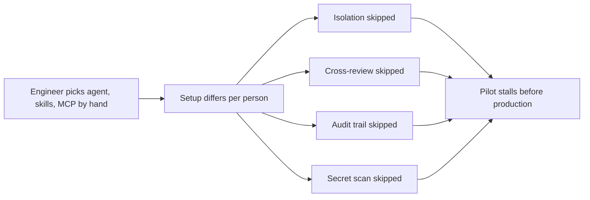
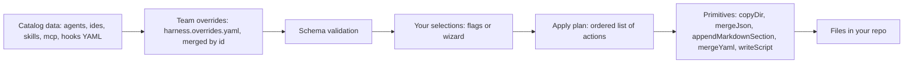
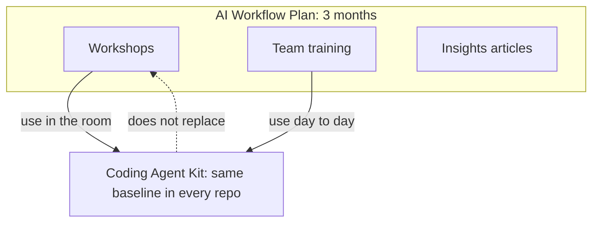

# 1. What the kit is and why it exists

> **In this chapter**
> The problem the kit solves, what it writes and what it refuses to do.
> How catalog data becomes files in your repo.
> Where the kit sits in the 3-month AI Workflow Plan.

## The problem

Engineers set up AI coding agents by hand. They pick an agent, copy skill files, edit MCP config and wire up an editor. Each person does this a little differently.

Hand-built setups drift. They also skip the steps that matter most:

| Step often skipped | Why it matters |
|---|---|
| Plan before code | Agents write code before the design is agreed |
| Isolated worktrees | Parallel agents collide on files |
| Review by a different model | The builder reviews its own work |
| Audit trail on agent commits | Nobody can tell who or what made a commit |
| Secret scanning | A key can reach a commit |

Source: `coding-agent-kit/README.md` ("Why") and `docs/superpowers/specs/2026-09-26-enclave-agent-kit-design.md` ("Problem").

The research behind the AI Workflow Plan puts a number on the cost. It reports that **88% of agent pilots never reach production**, and that the blocker is deployment infrastructure (isolation, governance, compliance controls), not the agent's raw capability. The figure is attributed to Northflank, May 2026. Source: `AI Workflow Research.md`, section 1.

The kit makes those steps the default. Every repo gets the same Enclave baseline.

## What the kit is

A command line wizard. You pick one agent, optional IDE or ADE, skills, MCP servers and safeguard hooks. It writes the config files those choices need. It does not overwrite what you already have.

| It is | Evidence |
|---|---|
| A one-shot file generator that exits when done | README: "Not a runtime. It writes files and exits." |
| Offline | README: "No network, no secrets." |
| Re-runnable, and re-running is the update path | README: "Re-runnable." |
| A data-driven catalog: 5 agents, 2 IDE/ADE, 57 skills, 10 MCP servers, 4 hooks | `catalog-data/*.yaml` |
| Extensible per team through `harness.overrides.yaml` | README: "Team overrides" |

## What the kit is not

These are the non-goals from the design spec.

| Not | Meaning |
|---|---|
| A runtime | It never runs or mediates your agent |
| A model or provider manager | Each agent keeps its own login and model picker. The kit prints a pointer as a next step |
| An installer | It does not install agent CLIs, IDEs or MCP runtimes. It prints the install command |
| A secrets tool | It never writes credentials or `.env` files |
| An auto-updater | No telemetry, no remote catalog. You re-run it to update |
| A replacement for training | It is a tool the program uses (see below) |
| A public, vendor-neutral tool | It is Enclave's stack. Team differences go in overrides |

Source: spec section "Non-goals".

## How it works

The catalog is data, not code. Adding a skill or MCP server is a YAML entry plus a template. Five primitives write the files.

Plan order is fixed: agent, then IDE or ADE, then skills, then MCP servers, then hooks. Source: `src/wizard/applyPlan.ts`, `buildApplyPlan`.

| Primitive | Writes | On re-run |
|---|---|---|
| `copyDir` | Skill folders | Identical files are a no-op. A different existing file is kept unless `--force` |
| `mergeJson` | `.mcp.json`, `.vscode/extensions.json` | Merged by key |
| `appendMarkdownSection` | `CLAUDE.md` or `AGENTS.md` | The kit's delimited section is replaced in place |
| `mergeYaml` | `.orca/config.yaml` | Merged by key |
| `writeScript` | Hooks such as `.git/hooks/pre-commit` | A different existing script is kept unless `--force` |

Source: spec section "Architecture"; behaviour confirmed by running the CLI. See [chapter 2](02-quickstart.md) for the exact outcomes.

## Where it fits in the AI Workflow Plan

The plan runs three months. Its mission is to help engineers get measurably better at using AI in software development. Its outputs are 1 to 2 workshops per month, team training sessions, and articles for Enclave Insights. Source: `AI Workflow Plan.md`.

The kit supports one part of that plan: a repeatable setup for the core flow (Plan, Parallelize, Verify, Cross-Review). It does not teach anyone how to use that flow.

| Plan item | Role of the kit |
|---|---|
| Workshops | Every attendee starts from the same repo setup |
| Team training | Teams add private skills through overrides |
| Measuring progress | The kit has no telemetry. See [chapter 6](06-measuring-effectiveness.md) |

## Try it

Time: 5 minutes. You need Node.js 18 or newer (see [chapter 2](02-quickstart.md)).

1. Run `npx @anscodelab/coding-agent-kit --help` from the repo root.
2. Find the five agent ids on the `--agent` line.
3. Find the line that says `Without --agent, runs the interactive wizard`.

Expected result: you see `claude-code, codex, cursor, github-copilot, omp` and the two usage lines. The command writes nothing.

Evidence the skills help is in [chapter 6](06-measuring-effectiveness.md).

## Next

[Chapter 2: Quickstart](02-quickstart.md)
