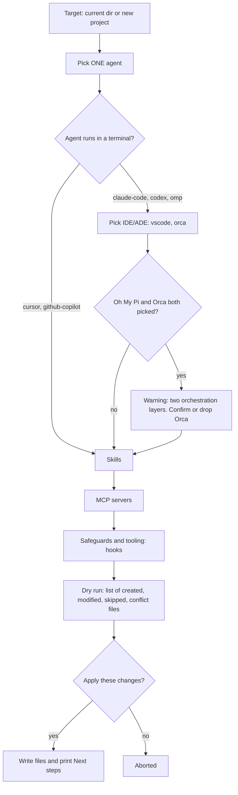
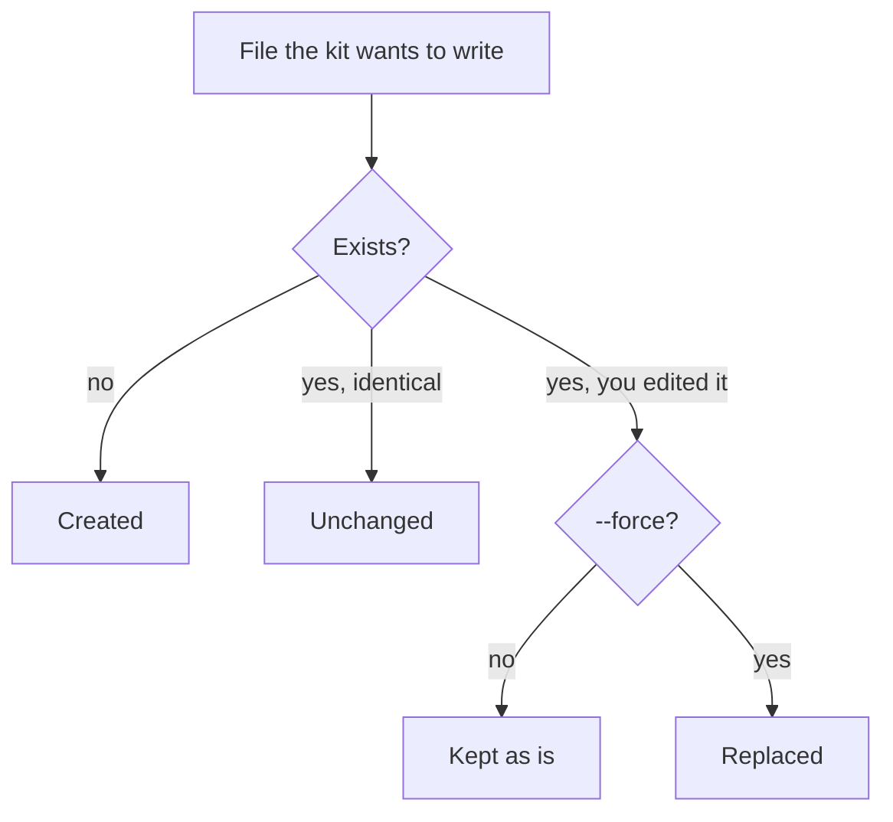

# 2. Quickstart

> **In this chapter**
> Install the kit from a clone, run the wizard, and run the non-interactive form.
> See which files each agent gets, and what a re-run or conflict does.
> Fix the four most common errors using the real message text.

## Run it

The kit is published on npm as `@anscodelab/coding-agent-kit`. You need Node.js 18 or newer. Run it from the repo you want to configure:

```sh
cd /path/to/your/repo
npx @anscodelab/coding-agent-kit
```

`npx @anscodelab/coding-agent-kit --version` prints the installed version, for example `0.1.5`.

Contributors can build from a clone instead: `cd coding-agent-kit && npm ci && npm run build`, then run `node /path/to/coding-agent-kit/dist/cli.js` in place of the `npx` command.

Source: `coding-agent-kit/README.md`, "Quickstart".

## The interactive wizard

Run the command with no `--agent` flag, in a terminal. The steps below come from `src/wizard/prompts.ts`.



| Step | What you choose | Defaults |
|---|---|---|
| Target | `Use current directory` or `Scaffold a new project` | Current directory |
| Agent | One of 5 | None. You must pick |
| IDE/ADE | `vscode`, `orca`. Skipped for Cursor and GitHub Copilot, because the agent is the editor | None selected |
| Skills | 56 choices. `using-superpowers` is always installed and is not shown | The 18 pre-checked core skills |
| MCP servers | 10 choices | Filesystem, GitHub, Atlassian |
| Safeguards and tooling | Hooks. Agent-specific hooks only appear for their agent | `secret-scan` |

The Oh My Pi plus Orca warning reads: "omp already does subagent fan-out + worktrees on its own. Running it under Orca too means two orchestration layers ... Continue with Orca selected? (y/n)". Answer no and the wizard drops Orca. It is a warning, not an error.

The dry run prints one line per file with its kind, for example `created    CLAUDE.md`. If nothing would change, the wizard prints a message starting `Nothing to do` and stops.

Passing a directory as the first argument creates a new project there and skips the Target step:

```sh
npx @anscodelab/coding-agent-kit my-new-project
```

## Non-interactive mode

Pass `--agent`. The command needs no terminal. Without `--yes` it only counts the plan and writes nothing.

```sh
cd /path/to/your/repo
npx @anscodelab/coding-agent-kit \
  --agent claude-code --ide vscode \
  --skills brainstorming,test-driven-development,ticket-flow \
  --mcp github,atlassian --hooks secret-scan
```

Output (verified):

```text
9 action(s) planned. Pass --yes to apply.
```

Add `--yes` to apply. Output (verified):

```text
Applied 9 action(s).

Next steps:
  - Install Claude Code (https://code.claude.com/docs/en/setup, or npm i -g @anthropic-ai/claude-code), then run `claude` and log in.
  - Install VS Code (https://code.visualstudio.com/download) and accept the recommended-extension prompt when you open the repo.
  - Install gitleaks (https://github.com/gitleaks/gitleaks); until then the hook only warns.
```

The kit never runs those installs. You do. Non-interactive mode has no per-file diff and does not print the Oh My Pi plus Orca warning.

| Flag | Meaning |
|---|---|
| `--agent <id>` | Turns on non-interactive mode |
| `--ide`, `--skills`, `--mcp`, `--hooks` | Comma-separated ids. `npx @anscodelab/coding-agent-kit --help` lists them |
| `--yes` | Apply. Without it, only report |
| `--force` | Replace hand-edited managed content. Allow a non-empty target dir |
| `--overrides <path>` | Team catalog file. Default: `./harness.overrides.yaml` if present |

## What each agent gets

Source: `catalog-data/agents.yaml`. Observed by running the CLI for `claude-code` and `codex`.

| Agent | Instructions file | Skills dir |
|---|---|---|
| Claude Code (`claude-code`) | `CLAUDE.md` | `.claude/skills/` |
| Codex (`codex`) | `AGENTS.md` | `.agents/skills/` |
| Cursor (`cursor`) | `AGENTS.md` | `.claude/skills/` |
| GitHub Copilot (`github-copilot`) | `AGENTS.md` | `.claude/skills/` |
| Oh My Pi (`omp`) | `AGENTS.md` | `.claude/skills/` |

Other files, by choice:

| Choice | File |
|---|---|
| MCP servers | `.mcp.json` |
| VS Code | `.vscode/extensions.json` (recommends the agent's official extension) |
| Orca | `.orca/config.yaml` |
| `secret-scan` | `.git/hooks/pre-commit` (executable) |
| `claude-usage-statusline` | `.claude/statusline.sh`, `.claude/settings.local.json` |
| `omp-auto-resume` | `.omp/extensions/auto-resume` |
| `gitwho` | A section in the instructions file |

The kit only edits its own section of `CLAUDE.md` or `AGENTS.md`. It marks it with `<!-- enclave-agent-kit:claude-code -->` and a closing comment. Text you already had in the file stays above it. Verified with an existing `CLAUDE.md`.

## Re-run and conflicts



| Situation | Without `--force` | With `--force` |
|---|---|---|
| Re-run with the same choices | Content unchanged | Content unchanged |
| Skill file you edited | Your file stays | Overwritten |
| `.mcp.json` entry you edited | Your entry stays | Overwritten |
| Existing `.git/hooks/pre-commit` that differs | Your script stays | Overwritten |
| Text inside the kit's own `CLAUDE.md` or `AGENTS.md` section | Replaced on every run (source: `appendMarkdownSection.ts`) | Same |

Observed in non-interactive mode: a re-run prints `Applied 9 action(s).` even when nothing changed, and kept edits are skipped silently. The interactive wizard shows them in the dry run as `skipped` or `conflict`. Run the wizard once if you need to see what a re-run would skip.

Put your own rules above or below the kit's section, not inside it.

## Troubleshooting

All messages below were produced by the CLI.

| Symptom | Real message | Fix |
|---|---|---|
| No terminal (CI, pipe, `</dev/null`) | `The interactive wizard needs a terminal. Run it in one, or pass --agent <id> --yes (see --help).` Exit code 1 | Use non-interactive mode |
| Unknown agent id | `coding-agent-kit: Unknown ids in your selection: agent "foo" (valid: claude-code, codex, cursor, github-copilot, omp)` | Use one of the listed ids. Same format for `ide`, `skill`, `mcp`, `hook` |
| Hook for the wrong agent | `coding-agent-kit: Not supported by agent "codex": hook "claude-usage-statusline" (supports: claude-code)` | Drop the hook or change the agent |
| Non-empty target directory | `coding-agent-kit: Target directory "/tmp/eakt" already exists and is not empty. Pass --force to scaffold into it anyway.` | Use an empty dir. Or add `--force`. Applies only when you pass a directory argument |

## Try it

Time: 10 minutes.

1. Make a scratch repo: `mkdir /tmp/eak-try && cd /tmp/eak-try && git init`.
2. Run the non-interactive example above without `--yes`. Expect `9 action(s) planned. Pass --yes to apply.` and no new files.
3. Add `--yes`. Expect `Applied 9 action(s).` and the Next steps list.
4. Run `ls -A` and `cat CLAUDE.md`. Expect `.claude`, `.mcp.json`, `.vscode`, `CLAUDE.md`, and the kit's marked section.
5. Run the same command again. Expect the same output and no content change.
6. Run `npx @anscodelab/coding-agent-kit --agent codex --hooks claude-usage-statusline --yes`. Expect the "Not supported by agent" message.

## Next

[Chapter 3: The flow](03-the-flow.md)
