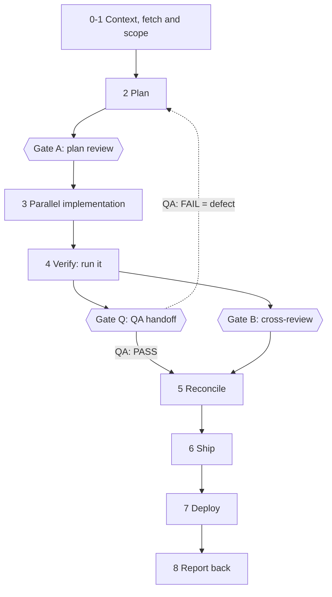
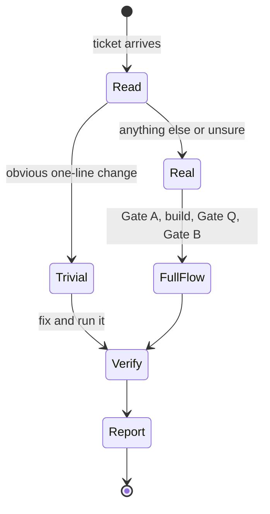
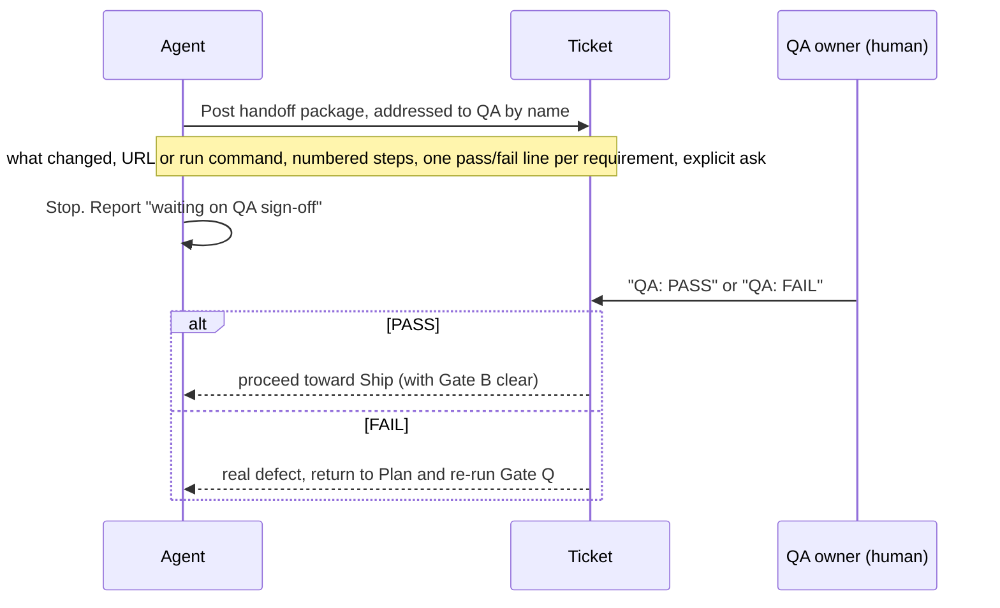

# 3. The flow: Plan, Parallelize, Verify, Cross-Review

> **In this chapter**
> The four-stage flow, the three gates (A, Q, B) and where each pre-checked skill sits in it.
> For each stage: what the research says, which skills implement it, the typical mistake, a 15 minute exercise.
> Sources: `AI Workflow Research.md` section 2, `ticket-flow` SKILL.md and its `references/`, `catalog-data/skills.yaml`.

## 3.1 The whole flow

The kit does not invent a process. It installs the one in `AI Workflow Research.md` section 2: **Plan, Parallelize, Verify, Cross-Review**. The `ticket-flow` skill turns those four stages into numbered phases and three gates.



Read the diagram like this:

- **Gate A** reviews the plan document alone, before any code exists.
- **Gate Q** is a human QA person signing off against the ticket's acceptance criteria.
- **Gate B** is a reviewer that did not write the code, ideally another model or vendor.
- Gate Q and Gate B may run at the same time. Ship is blocked until both are clear.
- Phase 8 (report back) is never skipped, not even for trivial tickets.

Source: phase table and Gate Q section in `catalog-data/skills/ticket-flow/SKILL.md`. The skill is the same for every tracker. Only the tracker calls differ, and they live in one file per tracker under `references/` (see [chapter 5](05-team-adaptation.md)).

### Proportionality: trivial or real?

The flow is not applied at full weight to every ticket. The skill says to read the ticket first.

| Bucket | Examples (from the skill) | What you run |
|---|---|---|
| Trivial | copy fix, config value, one-line guard, obvious typo | fetch, fix, run it, report back. Skip Gate A, Gate Q, Gate B. Never skip Verify or the report. |
| Real change | new behavior, bug with a non-obvious root cause, more than one file in a load-bearing way | the full flow above |

When unsure, treat the ticket as real. The skill gives the reason: downgrading a ticket that later needs Gate A, after code already exists, is the exact mistake the flow is built to prevent.



## 3.2 Stage 1: Plan

**What the research says.** The unit moving through the pipeline should be structured context (requirements, constraints, domain rules an agent can execute against), not only a human-readable ticket. Layer this on the existing SDLC and ticketing instead of replacing it. The bottleneck skill is spec writing, not tool operation. Engineers who write tickets for humans under-specify for agents: ambiguous acceptance criteria, missing constraints. (`AI Workflow Research.md`, "Plan".)

**Kit skills that implement it.**

| Skill id | Role in the stage |
|---|---|
| `brainstorming` | Design and approval gate before any implementation. The agent asks questions one at a time and waits for an explicit yes. |
| `writing-plans` | Turns an approved spec into a bite-sized plan with no placeholders. Large plans are split into per-milestone files. |
| `plan-to-tickets` | Turns an approved plan into tracker tickets. One ticket per demoable task. Needs human sign-off on the breakdown before any tracker call. |
| `ticket-flow` | Phases 0 to 2 and Gate A. Fetch the ticket, plan, then have an independent pass review the plan alone. |

All five ids are in `catalog-data/skills.yaml` and are pre-checked.

**Gate A.** A reviewer reads the plan document without the planning session's reasoning. A bad architecture call then costs a plan rewrite, not a codebase rewrite.

**Typical mistake.** Starting to code from a ticket written for humans. The ticket says "fix the login bug"; the agent invents the acceptance criteria. The second mistake is calling a real change "trivial" to skip Gate A.

**Benchmark evidence.** In `~/eak-testlab/REPORT.md`, `writing-plans` has the largest lift of any skill: mechanical score 0% to 100% on Claude Code, 4% to 94% on Oh My Pi, 2% to 98% on Cursor. See [chapter 6](06-measuring-effectiveness.md) for how to read these numbers.

### Exercise 1: spec clinic (15 minutes)

1. Pick one real ticket from your backlog that a human could do from a two-line description.
2. Rewrite it with: goal, constraints, one pass/fail line per requirement, files or modules likely touched.
3. Give both versions to your agent separately and ask only for a plan (no code). Use `writing-plans`.

**Expected result.** The plan from the rewritten ticket has concrete tasks, each with a test or check. The plan from the original ticket asks questions or guesses at requirements. Note which guesses were wrong.

## 3.3 Stage 2: Parallelize

**What the research says.** Define independent work units, give each its own isolated agent context (a worktree), run them concurrently, review and merge on completion. The research quotes one throughput case: five independent 2 hour tasks take 10 hours sequentially, and about 2 hours plus coordination overhead when parallelized with isolation (mindstudio.ai, Apr 2026, as cited in `AI Workflow Research.md`). The skill to learn is decomposition into units that do not collide on files, not tool operation.

**Kit skills that implement it.**

| Skill id | Role in the stage |
|---|---|
| `using-git-worktrees` | Detects existing isolation first, then uses native worktree tools, then falls back to `git worktree`. Checks for a clean baseline. |
| `dispatching-parallel-agents` | Decision rule: fan out only when problems are independent and share no state. |
| `subagent-driven-development` | Engine for plan execution: fresh implementer subagent per task, a review after each, a final whole-branch review, a ledger. |
| `executing-plans` | Sequential alternative: execute the plan in the current session with checkpoints. |
| `test-driven-development` | Discipline inside each unit: no production code without a failing test first. |
| `resolving-merge-conflicts` | When units are merged back and conflict: trace each side to its commit, PR or issue. |

**Typical mistake.** Fanning out units that touch the same file, schema or port. The dispatching skill says not to parallelize when failures are related or agents would interfere. Same-branch parallel work is the second mistake: use one worktree per unit.

**Benchmark evidence.** `dispatching-parallel-agents` shows +0 pts on all three agents, mechanical 100% to 100%: the scenario's checks pass without the skill, so the metric cannot see an effect. `using-git-worktrees` shows +0 (Claude Code), +48 (Oh My Pi), +11 (Cursor). Source: `~/eak-testlab/REPORT.md`, per-skill table.

### Exercise 2: three units, three worktrees (15 minutes)

1. Take one feature and list three units. Next to each, write the files it will touch.
2. If any file appears in two lists, merge those units or order them.
3. Create the worktrees:

```sh
git worktree add ../unit-a -b unit-a
git worktree add ../unit-b -b unit-b
git worktree add ../unit-c -b unit-c
git worktree list
```

**Expected result.** `git worktree list` prints four lines (main checkout plus three). Clean up with `git worktree remove ../unit-a` (and b, c) when done.

## 3.4 Stage 3: Verify

**What the research says.** Verification is the bottleneck: agents generate faster than humans can review, so automated gates must filter most regressions before a human sees a diff (Augment Code, Mar 2026). The reference pipeline has five layers: (1) tests, lint and security scan in CI, (2) a distinct AI review pass, (3) pre-commit checks, (4) a dev and verification agent loop where the verifier gives feedback instead of silently editing, (5) risk-triaged human review last.

**Kit skills and hooks that implement it.**

| Id | Kind | Role in the stage |
|---|---|---|
| `verification-before-completion` | skill | No completion claim without fresh command output in the same response. |
| `systematic-debugging` | skill | When a check fails: root cause first, no fixes before investigation. |
| `test-driven-development` | skill | The red-green record is the evidence that a test actually tests something. |
| `ticket-flow` | skill | Phase 4: run the changed path. For a bug ticket, reproduce the bug first, then show it no longer reproduces. Gate Q: human QA handoff. |
| `secret-scan` | hook | Pre-commit gitleaks scan on staged changes. Fails open with a warning if gitleaks is not installed. |

### Gate Q in detail

Verify proves the implementer's own tests pass. Gate B proves another reviewer is satisfied reading the diff. Neither is a human exercising the real thing against the ticket. Gate Q closes that gap.



Rules from the skill:

- The agent never posts the sign-off itself.
- Silence, green CI and "ship it, I take responsibility" from a manager are not sign-off.
- If the QA owner is unavailable, the question is who the new QA owner is. It is never "skip the gate".
- Sign-off is a QA-specific workflow transition if the tracker has one, otherwise a comment or note whose first line is exactly `QA: PASS` or `QA: FAIL`.

**Typical mistake.** Treating a model re-reading its own diff as verification. The skill is explicit: that is not verification. The second mistake is self-signing Gate Q to keep things moving.

**Benchmark evidence.** `verification-before-completion`: +5 (Claude Code), +3 (Oh My Pi), +22 (Cursor). `jira-ticket-flow`: +19, +31, +50. `mantis-ticket-flow`: +31, +17, +56 (the two were measured as separate skills and are now the single skill `ticket-flow`). All are mechanical lift in points, `~/eak-testlab/REPORT.md`. In the same report, `systematic-debugging` and `test-driven-development` show +0 on Claude Code and Oh My Pi where the skill was loaded in 0/20 and 1/20 runs (debugging) or 0/20 runs (TDD): the skill did not load, so the lift is not an effect of the skill's text.

### Exercise 3: reproduce first, then a handoff (15 minutes)

1. Take a bug ticket. Ask the agent to reproduce it and show the failing output before touching code.
2. Let it fix the bug, then show the same command passing.
3. Write the Gate Q package by hand: what changed, a URL or command, numbered steps, one pass/fail line per requirement, the explicit ask (`QA: PASS` or `QA: FAIL`).

**Expected result.** You have a failing run and a passing run of the same command, and a handoff a colleague can follow without opening the diff.

## 3.5 Stage 4: Cross-Review

**What the research says.** Self-review by the same agent or context misses defects, such as an off-by-one or a missing null check (MindStudio, Apr 2026). Same-family models share correlated blind spots and agree in the same places (Augment Code, Aug 2026). The fix is a genuinely different model or a fresh context. Triage by risk: types, schemas, config, auth boundaries and secrets get reviewed first (amux.io). The research confirms Gate B already requires this (closed 2026-09-26).

**Kit skills and hooks that implement it.**

| Id | Kind | Role in the stage |
|---|---|---|
| `ticket-flow` | skill | Gate B: reviewer that did not write the code, no implementer summary shown first, different vendor if possible (the `codex` skill when available), else an isolated same-vendor reviewer subagent. |
| `cross-model-review` | skill | The same rule for ad hoc work that is not a ticket. Iron law: no "ready to ship" without a review from a different model or vendor. |
| `requesting-code-review` | skill | How to dispatch the reviewer with precisely scoped context (diff range, requirement), never the session history. |
| `receiving-code-review` | skill | How to act on feedback: verify against the codebase, push back with reasons, no performative agreement. |
| `agent-commit-audit-log` | skill | `Agent-Model` and `Agent-Task` trailers on every agent commit, so the audit trail shows which model wrote what. |

**Typical mistake.** Asking the same session to "look again". The skill says a fresh context without the implementer's reasoning still beats same-session re-reading, but a different vendor is the target.

**Benchmark evidence.** `cross-model-review`: +0 on Claude Code (skill loaded in 0/20 runs), +32 on Oh My Pi, +10 on Cursor. `requesting-code-review`: +0, +18, +90. `agent-commit-audit-log`: +67 on all three. Source: `~/eak-testlab/REPORT.md`.

### Exercise 4: blind-spot comparison (15 minutes)

1. Take a small agent-written diff and its requirement.
2. In a fresh session, ask the same agent to review it. Save the findings.
3. In a second fresh session, with a different model if you have one, give only the diff and the requirement. Save the findings.

**Expected result.** Two lists. Compare them: anything found by only one is the blind-spot gap this stage exists to close. If both lists are identical, the diff was probably too easy; pick one that touches a schema or auth boundary.

## 3.6 Every pre-checked skill, by stage

The wizard pre-checks 18 skills. `using-superpowers` is installed always and is not a wizard choice. The stage column is this handbook's reading of each skill's description. The catalog has no stage field.

| Skill id | Stage | Gate or phase it serves |
|---|---|---|
| `using-superpowers` | all (forced) | Makes the agent look for and invoke the other skills before acting |
| `brainstorming` | Plan | Design approval before implementation |
| `writing-plans` | Plan | Phase 2, the plan Gate A reviews |
| `plan-to-tickets` | Plan | Splits an approved plan into tracker tickets |
| `ticket-flow` | all four | Phases 0 to 8, Gates A, Q, B (Jira, Mantis, GitHub Issues or a local ticket file) |
| `using-git-worktrees` | Parallelize | Isolated workspace per unit |
| `dispatching-parallel-agents` | Parallelize | Fan-out decision rule |
| `subagent-driven-development` | Parallelize | Phase 3 engine, with per-task review |
| `executing-plans` | Parallelize | Sequential execution with checkpoints |
| `test-driven-development` | Parallelize and Verify | Failing test before code |
| `resolving-merge-conflicts` | Parallelize | Merge units back |
| `verification-before-completion` | Verify | Phase 4, evidence before claims |
| `systematic-debugging` | Verify | Root cause before fixes |
| `requesting-code-review` | Cross-Review | Dispatch the Gate B reviewer |
| `receiving-code-review` | Cross-Review | Phase 5 reconcile |
| `cross-model-review` | Cross-Review | Gate B rule for non-ticket work |
| `agent-commit-audit-log` | Cross-Review and audit | Trailers on agent commits |
| `finishing-a-development-branch` | After Gate B and Q | Phase 6 ship: merge, PR or keep, exact-word confirmation for discard |
| `writing-skills` | Governance | Keeping and changing the skills themselves, outside the ticket flow |

Pre-checked MCP servers (`filesystem`, `github`, `atlassian`) and the pre-checked hook (`secret-scan`) support the same flow. See [chapter 4](04-catalog-guide.md).

## 3.7 What stays fixed

`AI Workflow Plan.md` says to work with teams on flow adjustments such as tracker integration and model routing, "keeping the core flow and gates fixed". Teams may change which tracker, which models and which extra skills. They may not remove Gate A, Gate Q or Gate B from real changes. [Chapter 5](05-team-adaptation.md) shows what a team can safely change.

## Try it

Install three flow skills into a throwaway directory and find the gates in the installed text.

```sh
cd "$(mktemp -d)"
npx @anscodelab/coding-agent-kit --agent claude-code \
  --skills ticket-flow,writing-plans,cross-model-review --yes
grep -n -E '^\| Gate [ABQ]' .claude/skills/ticket-flow/SKILL.md | cut -c1-40
ls .claude/skills
```

**Expected result (about 5 minutes).** `Applied 5 action(s).`, then three lines starting `| Gate A.`, `| Gate Q.` and `| Gate B.`, then four directories: `cross-model-review`, `ticket-flow`, `using-superpowers`, `writing-plans`. Then do Exercise 1 on one of your own tickets.

## Next

[Chapter 4: Catalog guide](04-catalog-guide.md)
