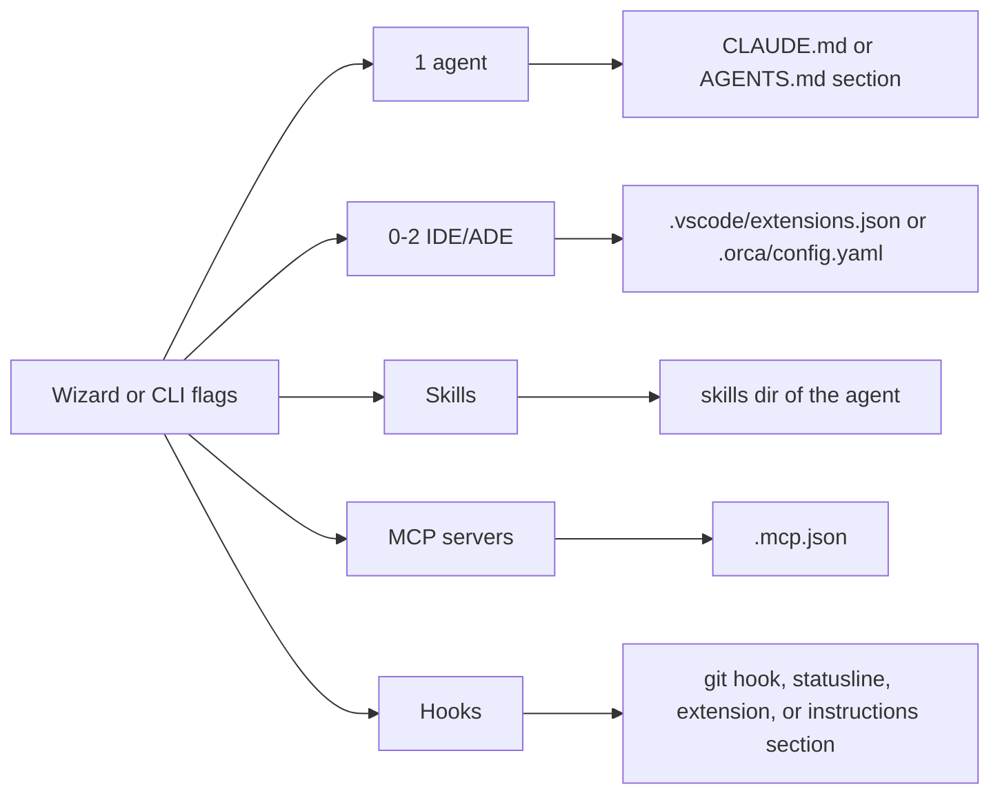
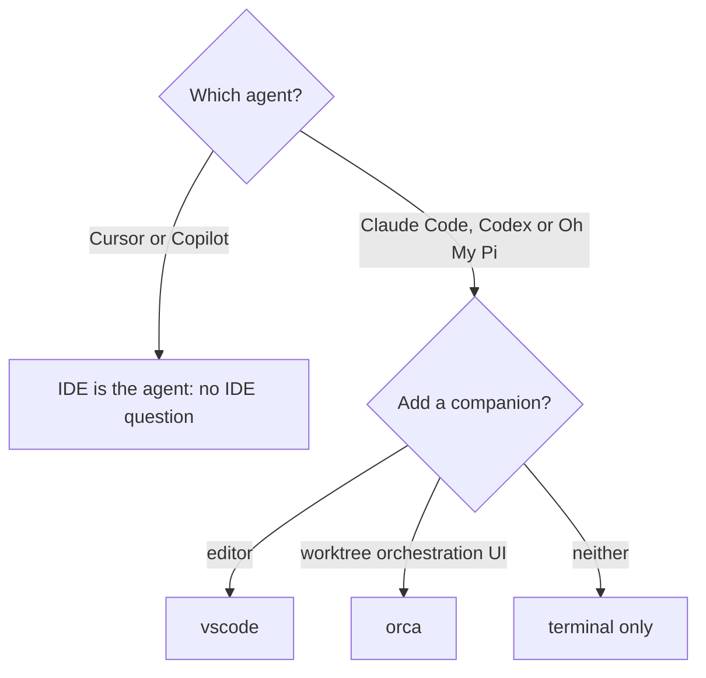
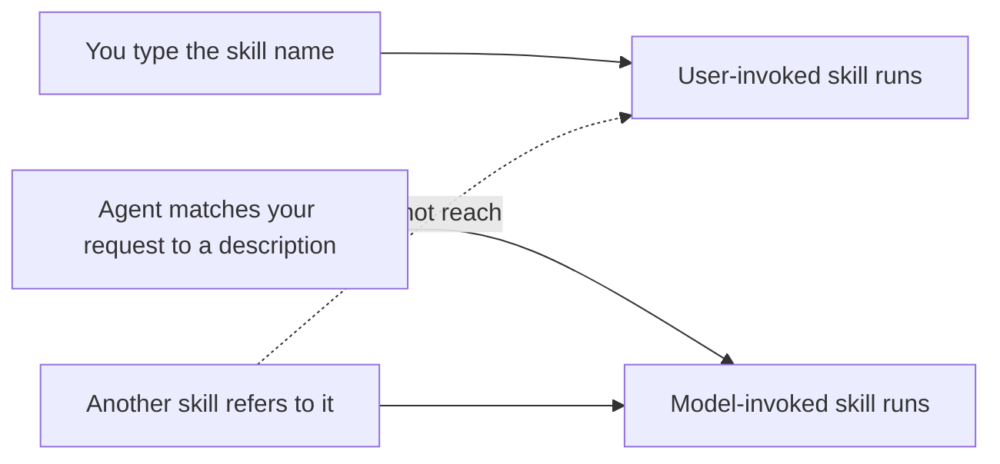
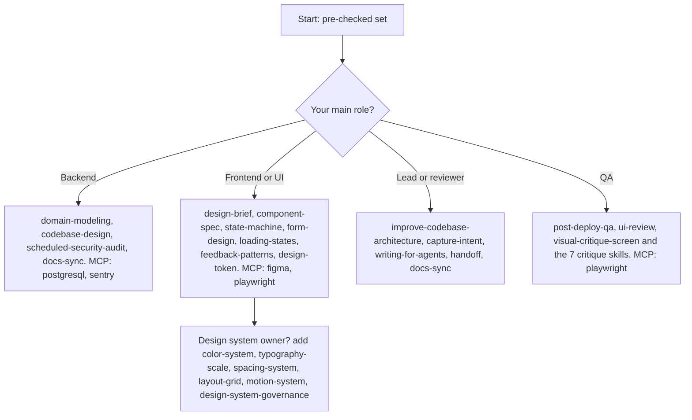

# 4. Catalog guide

> **In this chapter**
> Everything the wizard offers: 5 agents, 2 IDE/ADEs, 10 MCP servers, 4 hooks, 57 skills.
> What is pre-checked, what is user-invoked only, and a decision chart for which skills to tick by role.
> Sources: `coding-agent-kit/catalog-data/*.yaml` and each skill's `SKILL.md`.

## 4.1 The catalog at a glance

| Kind | Count | Pre-checked | Defined in |
|---|---|---|---|
| Agents | 5 | pick one | `agents.yaml` |
| IDE/ADE | 2 | none | `ides.yaml` |
| MCP servers | 10 | 3 (`filesystem`, `github`, `atlassian`) | `mcp.yaml` |
| Hooks | 4 | 1 (`secret-scan`) | `hooks.yaml` |
| Skills | 57 | 18 wizard choices, plus `using-superpowers` (forced, always installed) | `skills.yaml` |

Of the 57 skills, 56 are wizard choices: 18 pre-checked and 38 opt-in. The 38 opt-in skills split into 8 architecture and design, 5 maintenance and 25 UI/UX.



## 4.2 Agents (5)

You pick exactly one. The choice decides the instructions file and the skills directory.

| Id | Name | Instructions file | Skills dir | IDE/ADE offered | VS Code extension | Pick this when |
|---|---|---|---|---|---|---|
| `claude-code` | Claude Code | `CLAUDE.md` | `.claude/skills` | vscode, orca | `anthropic.claude-code` | Complex multi-file reasoning, terminal-first |
| `codex` | Codex | `AGENTS.md` | `.agents/skills` | vscode, orca | `openai.chatgpt` | Terminal agent with native subagent support |
| `cursor` | Cursor | `AGENTS.md` | `.claude/skills` | none (is the IDE) | none | IDE-native daily driver |
| `github-copilot` | GitHub Copilot | `AGENTS.md` | `.claude/skills` | none (is the IDE) | none | Lowest-friction enterprise rollout |
| `omp` | omp (Oh My Pi) | `AGENTS.md` | `.claude/skills` | vscode, orca | none | Built-in LSP, DAP debugging, subagent fan-out over worktrees, multi-provider routing |

Notes from `agents.yaml` and `applyPlan.ts`:

- Choosing `omp` together with `orca` triggers a warning in the wizard: both orchestrate subagents and worktrees, so you get two layers. It is allowed.
- The kit never installs the agent. It prints the install and login step under "Next steps", leaves out a step whose program is already on your PATH, and marks a tool the files work without (gitleaks) as "Optional:".

## 4.3 IDE and ADE (2)

| Id | Name | What it writes | Pick this when |
|---|---|---|---|
| `vscode` | VS Code | `.vscode/extensions.json` with the agent's official extension. Nothing is written if the agent has no confirmed extension id (`cursor`, `github-copilot`, `omp`). | Your team works in VS Code |
| `orca` | Orca | `.orca/config.yaml` entry for the chosen agent | You want an Agent Development Environment: isolated worktrees, embedded browser, many CLI agents |



## 4.4 MCP servers (10, 3 pre-checked)

All entries are written to `.mcp.json` under `mcpServers`, started with `npx -y <package>` (templates in `catalog-data/templates/mcp/`). The kit stores no credentials.

| Id | Pre-checked | Description in catalog | Pick this when |
|---|---|---|---|
| `filesystem` | yes | Read/write files | Agent needs file access through MCP |
| `github` | yes | Repos, issues, PRs | PR and issue work, Gate B on pull requests |
| `atlassian` | yes | Ticket and doc access (Jira/Confluence) | You run `ticket-flow` on Jira tickets |
| `playwright` | no | Browser automation | QA, `post-deploy-qa`, UI critique on a rendered screen |
| `postgresql` | no | Database access | Task needs real schema or data |
| `context7` | no | Library/API documentation lookup | Agent keeps guessing library APIs |
| `sentry` | no | Error tracking | Debugging from production errors |
| `linear` | no | Issue tracking | Your team tracks in Linear |
| `slack` | no | Messaging | Agent must read or post to Slack |
| `figma` | no | Design file access | Implementing from Figma files |

There is no MCP entry for Mantis in the catalog. `ticket-flow`'s `references/mantis.md` uses the `mantis_*` tools of the current session, so Mantis access comes from your own setup. See [chapter 5](05-team-adaptation.md) for adding it as a private server.

## 4.5 Hooks (4)

The catalog calls these "Safeguards and tooling". A hook with an `agents:` list is only offered for those agents.

| Id | Pre-checked | Agents | What it does | Needs |
|---|---|---|---|---|
| `secret-scan` | yes | any | Writes `.git/hooks/pre-commit`. Runs `gitleaks protect --staged --redact`. Fails open with a warning if gitleaks is missing. | gitleaks |
| `gitwho` | no | any | Appends a section to the agent's instructions file: stop and ask when a commit is blocked with "No profile set for this repo", never bypass the hook. | gitwho (`npm i -g @anscodelab/gitwho`) |
| `claude-usage-statusline` | no | `claude-code` only | Writes `.claude/statusline.sh` and a `statusLine` key in `.claude/settings.local.json`. Shows model plus 5h and 7d usage. | jq |
| `omp-auto-resume` | no | `omp` only | Copies a vendored extension to `.omp/extensions/auto-resume`. After a confirmed Anthropic usage-limit block it waits for reset and sends "continue". | omp |

Agent-restricted hooks fail fast on the CLI. Verified:

```text
$ npx @anscodelab/coding-agent-kit --agent codex --hooks omp-auto-resume --yes
coding-agent-kit: Not supported by agent "codex": hook "omp-auto-resume" (supports: omp)
```

Nothing is written when this error occurs.

## 4.6 Skills (57)

### Presets

The wizard and `--preset <ids>` install skills in bundles: `core` (18, the pre-checked set), `tickets` (11), `ui` (18), `maintenance` (5), `architecture` (8) and `everything` (all 56 choices). Bundles are defined in `catalog-data/presets.yaml`; each skill also has a `group` (core, architecture, maintenance, ui) that the wizard uses for its grouped list.


### How to read the tables

- "Pick this when" is a one-line summary of each skill's own description text.
- **User-invoked only** skills carry `disable-model-invocation: true` in their SKILL.md. There are three: `handoff`, `improve-codebase-architecture`, `visual-critique-screen`.

### What "user-invoked only" means

Per `writing-for-agents/SKILL-MECHANICS.md`:

- A model-invoked skill keeps a description, so the agent can fire it on its own and other skills can reach it.
- A user-invoked skill is only reachable when you type its name. The agent will not start it by itself, and no other skill can call it.
- The benefit is zero context load. The cost is that you must remember it exists.



### A. Core flow and governance (pre-checked: 18, plus the forced one)

| Id | Pick this when |
|---|---|
| `using-superpowers` | Always installed. Makes the agent check for and invoke skills before any response. |
| `brainstorming` | You are about to build or change behavior and need a design approved first. |
| `writing-plans` | You have a spec for a multi-step task and no code is written yet. |
| `executing-plans` | You have a written plan and want it run in one session with checkpoints. |
| `subagent-driven-development` | You have a plan of mostly independent tasks and want a fresh implementer plus a review per task. |
| `dispatching-parallel-agents` | There are 2+ independent tasks or failures with no shared state. |
| `using-git-worktrees` | You start feature work that needs isolation from the current workspace. |
| `test-driven-development` | You implement any feature or bug fix, before writing code. |
| `systematic-debugging` | You hit a bug, test failure or unexpected behavior, before proposing a fix. |
| `verification-before-completion` | You are about to say something is done, fixed or passing. |
| `requesting-code-review` | You finished a task or major feature, or are about to merge. |
| `receiving-code-review` | Review feedback arrived, especially if it looks unclear or questionable. |
| `finishing-a-development-branch` | Work is complete, tests pass, and you must pick merge, PR or keep. |
| `ticket-flow` | A ticket in Jira, Mantis, GitHub Issues or a local ticket file must be implemented. Runs the full flow with Gates A, Q, B, and reads one tracker reference file. |
| `plan-to-tickets` | An approved plan must become tracker tickets for a team to pick up. |
| `cross-model-review` | Non-trivial ad hoc work (not a ticket) is about to be called ready to ship. |
| `agent-commit-audit-log` | Any commit authored by an agent. Adds `Agent-Model` and `Agent-Task` trailers. |
| `resolving-merge-conflicts` | A git merge or rebase is in conflict. |
| `writing-skills` | You create, edit or verify a skill before deploying it. |

### B. Architecture and design (opt-in: 8)

| Id | Pick this when |
|---|---|
| `capture-intent` | A stakeholder hands you a raw, non-technical ask, before any technical framing. Not for requests that already name a technical change. |
| `domain-modeling` | You discuss domain terms, write a `CONTEXT.md` or record an ADR. |
| `codebase-design` | You design a module interface, decide where a seam goes, or want code that is more testable. |
| `improve-codebase-architecture` | **User-invoked only.** You want a scan for deepening opportunities, shown as an HTML report in the OS temp dir. |
| `prototype` | A design question is faster to answer with throwaway code (logic demo or UI variants). |
| `handoff` | **User-invoked only.** You end a session and a fresh agent must continue. Writes a redacted document to the OS temp dir. |
| `writing-for-agents` | You write or edit a skill, `AGENTS.md` or `CLAUDE.md`. |
| `find-skills` | Someone asks "is there a skill for X". Uses the skills.sh CLI with telemetry disabled. |

### C. Maintenance (opt-in: 5)

| Id | Pick this when |
|---|---|
| `docs-sync` | A change is about to be called finished and README, CHANGELOG, `AGENTS.md` or `docs/` may have drifted. |
| `scheduled-security-audit` | You want an OWASP-style sweep of a diff or repo, or are about to patch a Critical or High finding. Never auto-patches those. |
| `post-deploy-qa` | A release just reached a staging or production URL and needs a real-browser walk-through. Pair with the `playwright` MCP server. |
| `overnight-test-loop` | You want the suite run unattended in bounded rounds: every failure is verified before it counts as a bug or a ticket, each fix starts with a failing test, and a ledger records every round. Opt-in. |
| `acceptance-test` | A ticket has acceptance criteria to check in a running web app: one Playwright test per criterion, written without reading the diff, with pass or fail evidence for QA. |

### D. UI/UX (opt-in: 25)

Design (build new work):

| Id | Pick this when |
|---|---|
| `design-brief` | Kickoff of one project: problem, audience, constraints, success criteria. |
| `visual-hierarchy` | You compose new UI and need one deliberate primary action per view. |
| `state-machine` | A component has many interacting states and impossible ones must be designed out. |
| `loading-states` | Content takes time to arrive: skeletons, optimistic UI, progressive reveal. |
| `form-design` | The artifact is a form: field order, validation, multi-step, accessibility. |
| `feedback-patterns` | The system must acknowledge success or a change after a user action. |
| `component-spec` | You define a library component: props, states, variants, accessibility. |

Design system:

| Id | Pick this when |
|---|---|
| `design-token` | You establish the token layer (global, alias, component tiers). |
| `color-system` | You define or rebuild colour: tonal scales, semantic roles, contrast. |
| `typography-scale` | You establish type structure with a modular scale. |
| `spacing-system` | You standardise padding and margins from a base unit. |
| `layout-grid` | You establish page structure: columns, gutters, breakpoints. |
| `motion-system` | You standardise durations, easing and reduced-motion handling. |
| `design-system-governance` | Several teams contribute to the system: ownership, versioning, deprecation. |
| `ui-style-direction` | You start a marketing or product UI: choose a direction that is not the category default, write the brand files, pass a distinctness check. |
| `premium-visual-polish` | Tokens are applied and the UI is nearly done, but may still read as a generic template. |

Critique (review an already rendered screen):

| Id | Pick this when |
|---|---|
| `critique-visual-hierarchy` | Attention lands in the wrong place. |
| `critique-affordance` | Unclear what is clickable, or CTAs and states are hard to read. |
| `critique-color` | You need measured WCAG contrast and palette checks on one screen. |
| `critique-composition` | The layout feels off but hierarchy is fine. |
| `critique-typography` | You review type scale, readability and token compliance. |
| `critique-brand-consistency` | `mood.md`, `voice.md` and `tokens.md` exist and you check compliance. Does not invent brand rules. |
| `critique-information-density` | A screen feels overwhelming. |
| `visual-critique-screen` | **User-invoked only.** You want all 7 critiques in one deduplicated, severity-ranked fix list. |
| `ui-review` | You want a whole UI audited: measured axe, contrast, tap-target, overflow and console numbers at three viewports, a UX pass, one P1 to P3 list with evidence per item and a coverage line. Reports only, never fixes. |

Count check: 7 + 9 + 9 = 25.

### What the benchmark taught us about using these skills

From the [UI skills benchmark results](../superpowers/results/2026-10-13-ui-skills-benchmark-results.md):

- **Name the critique skills in your prompt.** In build tasks the seven `critique-*` skills did not load on their own: 0 of 8 builds when the brief asked for a critique, 0 of 4 when `ui-style-direction` told the agent to invoke them. On review-shaped prompts they did load (layer 2 fire rate 1.00).
- **`visual-critique-screen` is user-invoked only.** The agent never starts it; type its name.
- **Run `ui-review` as a loop: build, review, fix P1 and P2.** The loop arm ("run the ui-review skill on the result, fix every P1 and P2 item, and stop") had a median of 0 defects against 5 for the skills without the loop, and was the only arm to meet the 44 px target bar with zero console errors in 8 of 8 builds. `ui-review` itself never fixes, so the fix step must be in your prompt.
- **The token skills load when the request asks for tokens.** Adding "First define the design tokens" made `design-token`, `color-system` and `typography-scale` load in 6 of 8 builds, against none before.
- **Better-looking pages are not shown.** The skills cut template tells, but "fewer tells" means "differs from the template", not "looks good", and the owner rated no arm's design as good, the skill builds included.

## 4.7 Which skills do I tick?

Start from the pre-checked set. Then add by role. The role mapping below is a **proposal** of this handbook. The catalog itself only marks what is pre-checked.



Rules of thumb:

- More skills means more descriptions for the agent to match. Tick what you will use this quarter.
- `ticket-flow` covers every tracker with one skill. It is pre-checked and needs no per-tracker choice. Add the tracker's MCP server (or `gh`) separately.
- Re-running the kit with a different selection adds files. It does not remove skills you unticked earlier.

## Try it

Install a role set into a temp dir and list what landed. Example for a frontend engineer using Jira. Run it from anywhere.

```sh
cd "$(mktemp -d)"
npx @anscodelab/coding-agent-kit --agent claude-code --ide vscode \
  --skills ticket-flow,writing-plans,component-spec,state-machine,form-design \
  --mcp github,playwright --hooks secret-scan --yes
ls .claude/skills; cat .mcp.json | grep -c command; cat .vscode/extensions.json
```

**Expected result (about 10 minutes).** `Applied` followed by a count, then six skill directories (the five chosen plus `using-superpowers`), `2` for the two MCP commands, and a `recommendations` array with `anthropic.claude-code`. Then run the same command with `--agent codex --hooks omp-auto-resume` and confirm the "Not supported by agent" error.

## Next

[Chapter 5: Adapting the kit for a team](05-team-adaptation.md)
