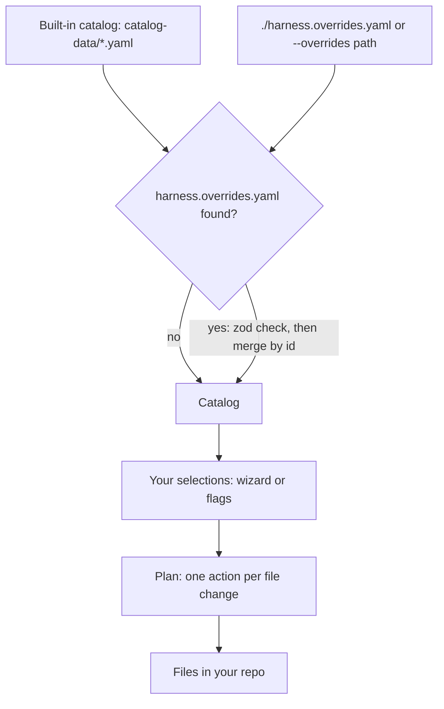
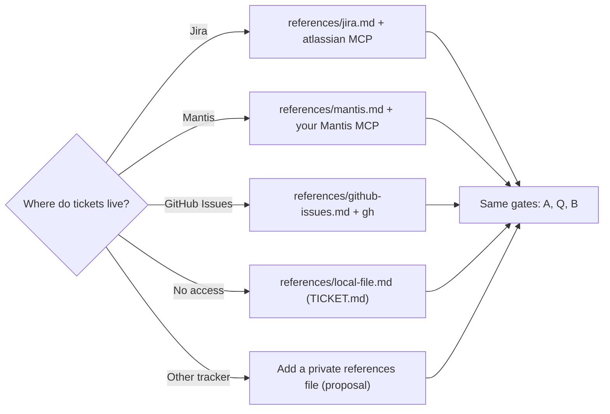

# 5. Adapting the kit for a team

> **In this chapter**
> How `harness.overrides.yaml` merges over the built-in catalog, with a tested example (a private MCP server, a private skill, a restricted hook).
> How agent placeholders, agent-restricted hooks and the tracker choice work.
> What a team may change, and what stays fixed: the core flow and the three gates.

## 5.1 Layering

The kit loads the built-in catalog, then merges your overrides file over it, then applies your selections to a repo. Source: `coding-agent-kit/src/catalog/load.ts`, `src/cli.ts`.



| Layer | Who owns it | Where it lives |
|---|---|---|
| Built-in catalog | Kit maintainers | `coding-agent-kit/catalog-data/*.yaml` |
| Team overrides | One team or repo | `harness.overrides.yaml` in the directory you run the kit from |
| Selections | Each engineer | Wizard answers or `--agent --skills --mcp --hooks --ide` flags |

## 5.2 Merge-by-id semantics

From `load.ts`:

```ts
function mergeById<T extends { id: string }>(base: T[], extra: T[] = []): T[] {
  const byId = new Map(base.map((entry) => [entry.id, entry]));
  for (const entry of extra) byId.set(entry.id, { ...byId.get(entry.id), ...entry });
  return [...byId.values()];
}
```

What this does, and what was observed by running the CLI:

| You write | Result |
|---|---|
| A new `id` | The entry is added after the built-in ones. It shows up in `--help` and in the wizard. |
| An existing `id` | The built-in entry is replaced field by field. Existing entries keep their position. |
| A partial entry | Rejected. The schema needs the full entry. See below. |

Five top-level keys are accepted: `agents`, `ides`, `skills`, `mcp`, `hooks`. Each is a list of full entries as defined in `src/types.ts`.

**Overrides must be complete entries.** Every entry is validated against the same schema as the built-in catalog before merging. A partial override of an existing server:

```yaml
mcp:
  - id: github
    defaultChecked: false
```

fails with:

```text
coding-agent-kit: Invalid harness.overrides.yaml: mcp.0.name: Required; mcp.0.description: Required; mcp.0.actions: Required
```

To change one field of a built-in entry, copy the whole entry from `catalog-data/` and edit it. Because the entry is complete, the `actions` list is replaced, not merged element by element.

Note: the design spec (`docs/superpowers/specs/2026-09-26-enclave-agent-kit-design.md`) says "deep-merged". The code above is a shallow merge per entry, and this handbook follows the code.

**Discovery.** The kit reads `./harness.overrides.yaml` from the current directory, or the path in `--overrides`. If an explicit `--overrides` path does not exist, `load.ts` returns the built-in catalog without an error. Check `--help` to confirm your entries appear.

**Template and source paths.** In an action, `template:` and `source:` are resolved inside the kit's own `catalog-data/` directory (`templates/` for templates), not relative to your repo or the overrides file. A private MCP template, skill or hook text must therefore sit in the kit copy your team runs. The example below does that.

### Action kinds

From `src/types.ts`. Each action says how one file is written.

| `kind` | Writes | Template or source |
|---|---|---|
| `copyDir` | A directory (skills, extensions) | `source:` under `catalog-data/` |
| `mergeJson` | `mcpServers.<entry id>` in the target JSON (used for `.mcp.json`) | `template:` rendering to a JSON object |
| `mergeJsonTop` | One top-level JSON key (e.g. `statusLine`) | `template:` plus `key:` |
| `mergeJsonArray` | The `recommendations` array in `.vscode/extensions.json` | `template:` |
| `appendMarkdownSection` | A delimited section in a Markdown file | `template:` |
| `mergeYaml` | A key in YAML (used for `.orca/config.yaml`) | `template:` |
| `writeScript` | An executable script (used for the pre-commit hook) | `template:` |
| `mergeToml` | Accepted by the schema, but `applyPlan.ts` throws "not implemented" | do not use |

## 5.3 A tested example

This example adds a private MCP server, a private skill and a restricted hook. Everything runs in a temp directory. It uses a copy of the kit so the real kit is untouched. Run it from the repo root.

```sh
KIT="$PWD/coding-agent-kit"
WORK="$(mktemp -d)"
cp -r "$KIT/dist" "$KIT/catalog-data" "$KIT/package.json" "$WORK/"
ln -s "$KIT/node_modules" "$WORK/node_modules"

# private assets live inside the kit copy's catalog-data
mkdir -p "$WORK/catalog-data/templates/mcp" "$WORK/catalog-data/templates/hooks" \
         "$WORK/catalog-data/skills/acme-release-notes"
echo '{ "command": "npx", "args": ["-y", "@acme/internal-docs-mcp"] }' \
  > "$WORK/catalog-data/templates/mcp/internal-docs.json.hbs"
printf '## Acme commit rules\n\nUse the ACME-123 ticket id as the first word of every commit subject.\n' \
  > "$WORK/catalog-data/templates/hooks/acme-commit-rules.md.hbs"
cat > "$WORK/catalog-data/skills/acme-release-notes/SKILL.md" <<'EOF'
---
name: acme-release-notes
description: Use when preparing release notes for an Acme service release.
---

# Acme release notes

Summarise merged PRs since the last tag. One line per user-visible change.
EOF

# the overrides file, in the repo you configure
mkdir "$WORK/repo" && cd "$WORK/repo"
cat > harness.overrides.yaml <<'EOF'
mcp:
  - id: internal-docs
    name: Internal docs
    description: Search the team wiki.
    defaultChecked: false
    actions:
      - kind: mergeJson
        target: .mcp.json
        template: mcp/internal-docs.json.hbs
skills:
  - id: acme-release-notes
    name: acme-release-notes
    description: Release notes for Acme services.
    defaultChecked: false
    actions:
      - kind: copyDir
        source: skills/acme-release-notes
        target: "{skillsDir}/acme-release-notes"
hooks:
  - id: acme-commit-rules
    name: Acme commit rules
    description: Adds the Acme commit subject rule to the agent instructions.
    defaultChecked: false
    agents: [claude-code, codex]
    actions:
      - kind: appendMarkdownSection
        target: "{agentInstructions}"
        template: hooks/acme-commit-rules.md.hbs
EOF

# 1. the new ids are visible
node "$WORK/dist/cli.js" --help | grep -c -E 'internal-docs|acme-release-notes|acme-commit-rules'
# 2. apply them
node "$WORK/dist/cli.js" --agent claude-code --skills acme-release-notes \
  --mcp internal-docs --hooks acme-commit-rules --yes
ls .claude/skills
grep -c 'Acme commit rules' CLAUDE.md
# 3. the restricted hook is refused for omp
node "$WORK/dist/cli.js" --agent omp --hooks acme-commit-rules --yes
```

Observed output:

- Step 1 prints `3` (one line each from the `--mcp`, `--hooks` and skill id lists).
- Step 2 prints `Applied 5 action(s).`, lists `acme-release-notes` and `using-superpowers` under `.claude/skills`, and `.mcp.json` contains `internal-docs`. The grep prints `1`.
- Step 3 prints `coding-agent-kit: Not supported by agent "omp": hook "acme-commit-rules" (supports: claude-code, codex)` and exits with code 1.
- Running step 2 again changes nothing: the Markdown section is delimited by `<!-- enclave-agent-kit:acme-commit-rules -->` markers and is not duplicated.

What this shows:

| Piece | Why it works |
|---|---|
| New MCP id `internal-docs` | `mergeJson` writes the rendered JSON under `mcpServers.internal-docs` in `.mcp.json` |
| New skill id `acme-release-notes` | `copyDir` copies the skill directory into the agent's skills dir |
| `{skillsDir}` | Replaced by the selected agent's `skillsDir` (`.claude/skills` for `claude-code`) |
| `{agentInstructions}` | Replaced by the agent's own instructions file (`CLAUDE.md`) |
| `agents: [claude-code, codex]` | Any other agent is rejected before anything is written |

## 5.4 Agent placeholders

Entries must work for every agent, but agents read different places. Two placeholders resolve at apply time (`resolveTarget` in `src/wizard/applyPlan.ts`).

| Placeholder | Where it may appear | Resolves to |
|---|---|---|
| `{skillsDir}` | Start of a `copyDir` or `appendMarkdownSection` target, e.g. `{skillsDir}/my-skill` | The agent's `skillsDir`: `.agents/skills` for `codex`, `.claude/skills` for `claude-code`, `cursor`, `github-copilot`, `omp` |
| `{agentInstructions}` | The whole target of an `appendMarkdownSection` action | The target of the agent's own `appendMarkdownSection` action: `CLAUDE.md` for `claude-code`, `AGENTS.md` for the others |

Other facts from the same file:

- `mergeJson`, `mergeJsonTop`, `mergeYaml` and `writeScript` targets are used as written. Placeholders are not resolved there.
- Templates rendered by `appendMarkdownSection` can use `{{skillsDir}}`. Orca's `mergeYaml` template can use `{{agentId}}`.
- If you add a new agent through overrides, give it an `appendMarkdownSection` action. Otherwise `{agentInstructions}` has nothing to resolve to and the plan fails with `has no instructions file`.
- A new agent entry needs `skillsDir`, `ideRelationship` and `actions`. `vscodeExtensionId` is optional, and the catalog comment says never to guess a marketplace id.

## 5.5 Agent-restricted hooks

A hook with `agents: [ids]` is offered only for those agents in the wizard (`hookSupportsAgent` in `applyPlan.ts`), and rejected on the CLI for others, with nothing written. Without `agents:` a hook works with any agent.

| Hook | Restriction | Reason in catalog |
|---|---|---|
| `claude-usage-statusline` | `claude-code` | Writes `.claude/statusline.sh` and `settings.local.json`, which only Claude Code reads |
| `omp-auto-resume` | `omp` | Vendored Oh My Pi extension. Claude Code already resumes natively via `/config`. |
| `secret-scan`, `gitwho` | none | Git hook and instructions section work anywhere |

Use `agents:` for your own hooks whenever the file you write is read by one agent only.

## 5.6 Tracker choice: one skill, one reference file per tracker

There is one ticket flow skill, `ticket-flow`. Phases and gates are written once in its `SKILL.md`. The tracker calls live in `references/`, one file per tracker, and the agent reads only the file that matches the ticket.



The skill picks the file from the ticket id (`PROJ-1234` is Jira, `#1234` or the word Mantis is Mantis, `#123` with a GitHub remote is GitHub Issues), from which tools exist in the session, or by asking the user once.

| Operation | Jira | Mantis | GitHub Issues | Local file |
|---|---|---|---|---|
| Fetch | `getJiraIssue` | `mantis_issues_get` | `gh issue view` | Read `TICKET.md` |
| QA owner | Assignee, or `lookupJiraAccountId` for a named person | Handler field | Assignee | `QA` row of the ticket |
| Post | `addCommentToJiraIssue` | `mantis_issue_note_add` | `gh issue comment` | `QA_HANDOFF.md` plus a pointer under Comments |
| Sign-off | A QA transition from `getTransitionsForJiraIssue`, else a comment starting `QA: PASS` or `QA: FAIL` | A QA status found via `mantis_project_custom_fields` and `mantis_config_get`, else a note starting `QA: PASS` or `QA: FAIL` | A comment starting `QA: PASS` or `QA: FAIL` | The same line, under Comments, from the QA owner |
| Transition | `transitionJiraIssue`, only after the user confirms | `mantis_issues_update`, only after the user confirms | `gh issue close`, only after the user confirms | Edit `Status`, only after the user confirms |
| Time logging | Out of scope | Out of scope here; the `mantis-timesheet` skill handles hours | Out of scope | Out of scope |
| MCP server in catalog | `atlassian` (pre-checked) | none | `github` (pre-checked), or the `gh` CLI | none needed |

Practical rules:

- There is nothing to tick per tracker. `ticket-flow` is pre-checked. `plan-to-tickets` hands each ticket it files to it (Jira Blocks links or Mantis parent/child links).
- The GitHub Issues reference was checked against `gh issue --help` only. It has not been run against a real repository.
- For Mantis, bring the Mantis MCP server yourself. Add it as a private `mcp` entry as in section 5.3, and add the server to the repo with `--mcp <your-id>`. The `mantis-timesheet` skill is not in this kit's catalog.
- Linear has an MCP server in the catalog but no tracker reference. **Proposal:** copy `references/jira.md` into a private skill's references folder, replace only the tracker calls, and keep phases and gates word for word.

## 5.7 What stays fixed

`AI Workflow Plan.md` allows flow adjustments such as tracker integration and model routing, "keeping the core flow and gates fixed". Concretely:

| Safe to change | Keep fixed |
|---|---|
| Which tracker and which MCP server | Plan, Parallelize, Verify, Cross-Review order |
| Which agent and which models review | Gate A (plan review) on real changes |
| Extra private skills, hooks, MCP servers | Gate Q (human QA sign-off), never self-signed |
| Which opt-in skills are pre-checked (`defaultChecked`) | Gate B (reviewer that did not write the code) |
| Commit rules appended to instructions | Phase 8, report back, on every ticket |

Be careful with one override: replacing a flow skill id such as `ticket-flow` swaps its whole entry. Changing `defaultChecked` to `false` only affects the wizard default. Replacing the `copyDir` source with a rewritten skill is how a gate would get removed, so review such changes like code.

## Try it

Run the full example in section 5.3, then change one thing:

1. Edit `harness.overrides.yaml`, set `defaultChecked: true` on `acme-release-notes`.
2. Run `node "$WORK/dist/cli.js" --help | grep -c acme-release-notes` from `$WORK/repo`.
3. Replace an existing entry on purpose: add a partial `github` entry (`id` and `defaultChecked` only) as the first item under `mcp:` and run `--help` again.

**Expected result (about 15 minutes).** Step 2 still lists the id. Step 3 fails with `Invalid harness.overrides.yaml: mcp.0.name: Required; mcp.0.description: Required; mcp.0.actions: Required`. Remove the partial entry to recover.

## Next

[Chapter 6: Measuring effectiveness](06-measuring-effectiveness.md)
