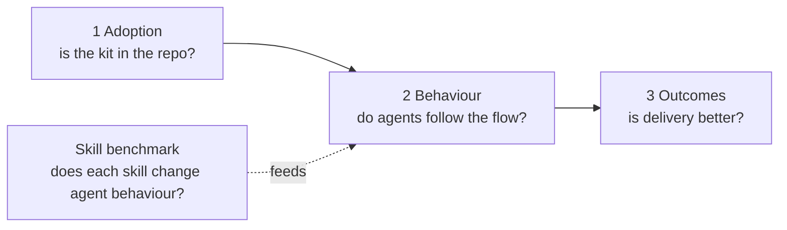
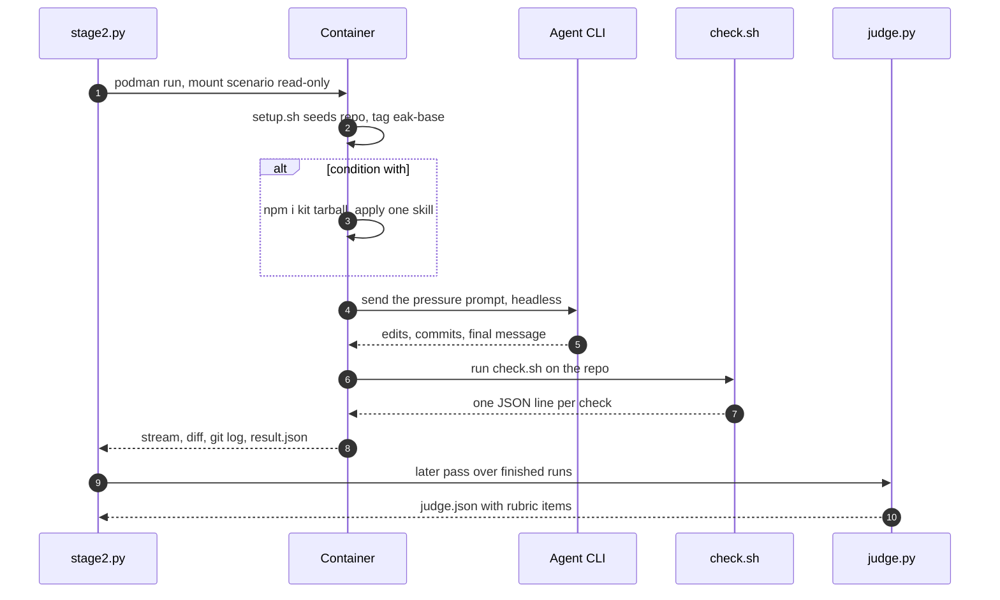
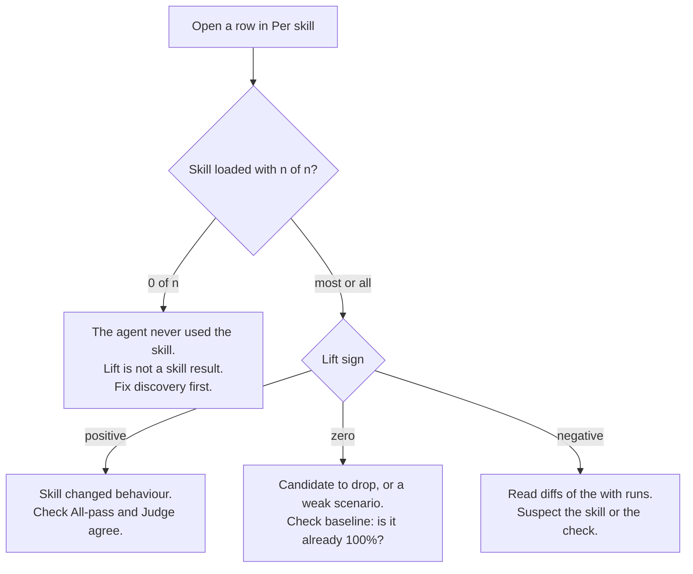
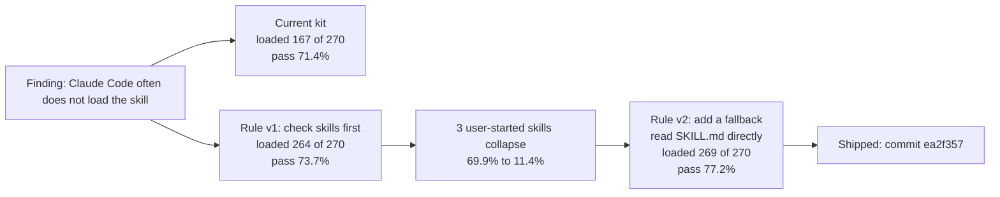

# 6. Measuring effectiveness

> **In this chapter**
> How to tell whether the kit works: a 3-layer evidence model with queries you can run today, and a skill benchmark you can rerun.
> How to read `REPORT.md`, what its numbers cannot tell you, and a case where a wrong measurement led to a wrong decision.
> An adoption checklist for a team rollout.

The kit has no telemetry, by design. Evidence comes from git, trackers and a benchmark. Take a baseline **before** a wider rollout. Without it, "measurably better" (the mission in `AI Workflow Plan.md`) cannot be shown.

## Part A. The 3-layer evidence model



Read left to right. Weak adoption makes the later layers meaningless. The benchmark in Part B answers a different question: does a skill change what an agent does, in a controlled run.

### Layer table

"Computable today" means the signal exists in git or a tracker now and I ran the query. "Proposal" means it needs a change before you can count it.

| Layer | Metric | Query or signal | Status |
|---|---|---|---|
| 1 Adoption | Repos with the kit | In each repo: `grep -l '<!-- enclave-agent-kit:' CLAUDE.md AGENTS.md 2>/dev/null`. The kit writes this marker around its section. | Computable. Org-wide means looping over clones. |
| 1 Adoption | Skills installed | `ls .claude/skills` (Codex: `.agents/skills`) | Computable |
| 1 Adoption | Secret-scan hook present | `grep -c coding-agent-kit .git/hooks/pre-commit` | Computable per clone. `.git/hooks` is not versioned, so it cannot be read from the remote. |
| 2 Behaviour | Share of commits with an agent trailer | `git log --no-merges --since=2026-09-01 --format=%H \| wc -l` and the same with `--grep='^Agent-Model:'` | Computable. This repo: 22 of 46. |
| 2 Behaviour | Which models commit | `git log --format='%(trailers:key=Agent-Model,valueonly)' \| sed '/^$/d' \| sort \| uniq -c` | Computable. Values are free text, so one model shows up under several spellings. This repo has 4 distinct strings. Normalise before you compare. |
| 2 Behaviour | Plan docs written | `git log --diff-filter=A --name-only --format= -- 'docs/superpowers/plans/*' \| sed '/^$/d' \| wc -l` | Computable. This repo: 2 plan files. |
| 2 Behaviour | Plan before code on a branch | `git log --reverse --name-only --format='commit %h %s' main..HEAD` and read the order | Computable per branch, read by a human |
| 2 Behaviour | Review by a different model | The skill requires it but writes no record | Proposal: add a `Reviewed-by-model:` trailer to `cross-model-review` |
| 2 Behaviour | Secret-scan blocks | The hook prints to the terminal and keeps no log | Proposal: needs a log line or CI scan |
| 3 Outcomes | Reverts | `git log --grep='^Revert' --oneline \| wc -l` | Computable. This repo: 1. A revert can also be a good outcome, as in the CLAUDE.md case below. |
| 3 Outcomes | PR cycle time | `gh pr list --state merged --json number,createdAt,mergedAt` | Computable. Caution: in this repo PRs 3 and 4 merged about 30 seconds after opening with 0 reviews, so the number reflects no review at all. |
| 3 Outcomes | Review activity | `gh pr list --state merged --json number,reviews` gives review records per PR | Computable |
| 3 Outcomes | Token cost per ticket | `ticket-flow` requires a closing comment such as "~42k tokens across 4 agent passes". Search the tracker for that text. | Depends on teams using the ticket flow. Query not tested. |
| 3 Outcomes | Review time per 10 branches | `AI Workflow Research.md` cites 60 to 90 minutes as a target, from amux.io | Needs timing data the repo does not have |
| 3 Outcomes | Change failure rate, lead time | CI and deploy data | Outside this repo. Not computed here. |

### Rules for using the table

1. Count over the same window before and after the rollout.
2. Do not rank people by trailer counts. A trailer can be added without thought.
3. A rising trailer share shows habit. It does not show better code. Pair it with layer 3.

## Part B. The skill efficacy benchmark

The question: does installing ONE kit skill change what a real coding agent does, compared with the same agent with no skills?

### Method

| Item | Choice |
|---|---|
| Unit | One run = one skill, one agent, one condition (baseline or with), one trial |
| Isolation | A fresh `podman run --rm` container per run, a freshly seeded repo, no credentials in the image |
| Condition "baseline" | The agent runs with no kit skills |
| Condition "with" | The kit tarball is installed and applied with only that skill: `npx @anscodelab/coding-agent-kit --agent <id> --skills <skill> --yes` |
| Agents | Claude Code, omp, Cursor CLI. All headless and single shot. |
| Prompt | A pressure prompt that makes the skill's target failure the easy path. It must not name the skill. |
| Scenarios | 53, one for each skill that existed when the measurements were made, in `scenarios/<skill>/`. Skills added later (`ui-style-direction`, `acceptance-test`) have no scenario yet and are not part of the results below. The results below were measured on 54: `jira-ticket-flow` and `mantis-ticket-flow` were measured separately; they are now one skill (`ticket-flow`) with one merged scenario. |
| Mechanical checks | Deterministic bash checks over files, git history and the final message. Proven with a golden script and an untouched repo. |
| Judge | A model scores `rubric.md` yes/no items, blind to the condition. It sees the prompt, final message, diff and tool trace, never the skill files. |
| Skill loaded? | Detected from the stream: the agent invoked the skill or read its `SKILL.md` |

Rules from `scenarios/CONTRACT.md`: an agent that correctly stops to ask must be able to PASS. Skills that only run when the user names them get the same "Use the <skill> skill." opener in both conditions.

### One run



### Scripts (all live in `~/eak-testlab/`)

| File | What it does |
|---|---|
| `agent-image/Containerfile` | Image `eak-agents:latest` with Node 24, git, Claude Code, omp and Cursor CLI. No credentials. |
| `kit-verify-image/Containerfile` | Image `eak-kit-verify:latest` that has the kit installed, used by `verify.sh` |
| `pack-kit.sh` | Builds the kit in a container and writes the tarball to `kit-tgz/` plus `KIT_COMMIT` |
| `scenarios/CONTRACT.md` | The rules for writing a scenario |
| `scenarios/<skill>/` | `scenario.json`, `setup.sh`, `check.sh`, `golden.sh`, `rubric.md` |
| `scenarios/verify.sh <skill>` | Proves a scenario discriminates: checks fail on an untouched repo and pass on the golden one, with and without the kit installed |
| `stage1.sh`, `stage1.mjs` | Install tests of the packed kit on Node 18 and 24 |
| `stage2.py run` / `one` | The runner. Resumable: a run with a `result.json` is skipped. Pauses an agent for 30 minutes on a usage limit. |
| `extract_final.py` | Pulls the final message and token usage from each agent's stream format |
| `skill_loaded.py` | Prints 1 if the agent loaded the skill |
| `judge.py` | Scores finished runs with the rubric. Writes `judge.json` per run. |
| `judge-loop.sh` | Repeats `judge.py` until no run is left unjudged |
| `report.py` | Writes `REPORT.md` and `results.csv` from all results |

### Run it yourself

I ran only the first command below, and it passed (`VERDICT: OK`). The others start real agents or need your credentials, so I did not run them. Treat them as taken from the scripts, not as tested.

```sh
# 1. prove a scenario works (no agent, no credentials; needs the eak-kit-verify image)
bash ~/eak-testlab/scenarios/verify.sh agent-commit-audit-log

# 2. one-time: store credentials as podman secrets (names are read by stage2.py and judge.py)
podman secret create eak_claude_token -     # Claude Code and omp
podman secret create eak_cursor_key -       # Cursor
podman secret create eak_judge_openai -     # judge, or eak_judge_gemini

# 3. build the agent image and the kit tarball
podman build -t eak-agents:latest ~/eak-testlab/agent-image
bash ~/eak-testlab/pack-kit.sh

# 4. run one skill on one agent, 3 trials, baseline and with
python3 ~/eak-testlab/stage2.py run --skills agent-commit-audit-log --agents omp --trials 3 --parallel 3

# 5. judge, then report
python3 ~/eak-testlab/judge.py
python3 ~/eak-testlab/report.py
```

Notes:

- `report.py` overwrites `~/eak-testlab/REPORT.md` and `results.csv`, and reads only `~/eak-testlab/results/`. Copy `REPORT.md` first if you want to keep it. `EAK_RESULTS` moves where `stage2.py` writes, but `report.py` does not follow it.
- `judge.py` prefers the OpenAI or Gemini secret. With neither, it falls back to Claude.
- Other switches in `stage2.py`: `EAK_CONDS`, `EAK_KIT_DIR`, `EAK_CURSOR_MODEL`.

### What must move into the repo

The harness lives outside the repo today. Paths are hardcoded to this machine (`~/eak-testlab`, and the kit path in `pack-kit.sh` and `stage2.py`). To let others rerun it, the repo would need:

| Move | Why |
|---|---|
| The 53 `scenarios/` directories and `CONTRACT.md` | They are the test cases and belong with the skills they test |
| The scripts in the table above and both Containerfiles | Anyone can rebuild the images |
| Paths read from the repo root or an env var, not hardcoded | The scripts run on any clone |
| A short README for credentials as podman secrets | Secrets stay out of the repo |
| A decision on whether `results/` and `REPORT.md` are committed | Results are 5,377 run folders. A summary file is enough to commit. |

This is a proposal. Suggested home: a `bench/` directory beside `coding-agent-kit/`.

### Headline numbers

Source: `~/eak-testlab/REPORT.md`, generated from 5,377 runs (`results.csv`). Status: **final for Claude Code and omp** (20 trials per skill and condition, 2,160 runs each). **Cursor is partial**: Auto model, about 9 trials per skill and condition (1,057 runs), stopped by its monthly plan limit, which resets on 10/19. "Lift" is mechanical pass rate with the skill minus without, averaged over 54 skills.

| Agent | Mean lift | Skills helped | No effect | Hurt |
|---|---|---|---|---|
| Claude Code | +25.5 pts | 37 | 13 | 4 |
| omp | +30.6 pts | 46 | 5 | 3 |
| Cursor | +36.1 pts | 47 | 4 | 3 |

Judge averages (rubric pass, without the skill to with it): Claude Code 41% to 59%, omp 43% to 70%, Cursor 31% to 61%. Read these as secondary to the mechanical checks. The judge is Claude Sonnet, the same vendor as the Claude Code and omp runs (the first 1,749 runs were scored by Opus), and it is blind to the condition but not independent of the agents it scores.

Does loading matter? Mechanical pass rate when the skill was loaded versus not (REPORT.md, section "Did the skill load"):

| Agent | Baseline | With, loaded | With, not loaded | Runs that loaded it |
|---|---|---|---|---|
| Claude Code | 46% | 82% | 56% | 679 of 1,080 |
| omp | 47% | 80% | 61% | 916 of 1,080 |
| Cursor | 46% | 82% | 61% | 525 of 528 |

Cost per run, median (REPORT.md): Claude Code $0.056 baseline, $0.061 with. omp $0.054 baseline, $0.082 with. Seconds: omp 31 baseline, 37 with. Cursor cost is not reported.

Install footprint (REPORT.md): the tarball is 228K and installs in 3.7 s. Applying 19 skills writes 60 files (548K) in about 170 ms. Applying all 54 writes 103 files (792K).

### Charts


*Figure 1. Mean lift by agent. Source: `~/eak-testlab/REPORT.md`, "Per agent".*


*Figure 2. Lift by skill. Source: `~/eak-testlab/REPORT.md`, "Per skill". The chart shows the skills as measured, so it lists `jira-ticket-flow` and `mantis-ticket-flow` as two rows.*


*Figure 3. Whether the skill was loaded versus pass rate. Source: `~/eak-testlab/REPORT.md`, "Did the skill load".*

### How to read REPORT.md



Worked examples from the Per skill table:

| Row | What it shows |
|---|---|
| `agent-commit-audit-log`, Claude Code | 20 of 20 loaded. Mechanical 33% to 100%, all-pass 0% to 100%. A clear gain. |
| `brainstorming`, Claude Code vs omp | Claude Code loaded it 0 of 20 times, lift +0. omp loaded it 20 of 20 times, lift +65 pts. Same skill, so loading explains the gap. |
| `dispatching-parallel-agents` | Baseline is 100% already, lift +0 on all three agents. The checks do not separate the two conditions here. |
| `domain-modeling`, Claude Code | 0 of 20 loaded and lift -12 pts. With no load, the gap is noise or kit side effects. Read the diffs before you conclude anything. |

Columns: **Mechanical** is the mean share of deterministic checks passed. **All-pass** is the share of runs that passed every check. **Judge** is the rubric score. Look for rows where all three move together.

### Caveats

| Caveat | Meaning |
|---|---|
| Cursor model | Cursor ran on Auto. The `Model per agent` line in REPORT.md shows no model name for it, so the underlying model is unknown and may differ between runs. |
| Cursor sample | Cursor stopped near 9 or 10 trials per cell (the `n` column) because of its monthly plan limit. Claude Code and omp have 20. |
| Same-vendor judge | The judge is Claude Sonnet, the same vendor as the Claude Code and omp runs, and the first 1,749 runs were scored by Opus. It is blind to the condition, but it is secondary to the mechanical checks. `judge.py` is built to prefer an OpenAI or Gemini key, and fell back to Claude here. |
| Mechanical checks are proxies | A check sees a trailer or a file. It does not see whether the plan was good. The judge covers some of that. |
| Pressure prompts | Scenarios are built to tempt the agent. Rates are not production rates. |
| Skill-loading | A skill that is never loaded cannot show lift. That is a finding about discovery, not about the skill. |
| Partial Cursor data | Cursor numbers rest on about 9 trials per cell and may move if the runs are resumed. |

## Lesson: measure before shipping, and check the measurement

Claude Code loaded the installed skill in only about two thirds of runs, and runs that did not load it scored close to having no skill. Three versions of a fix were A/B tested: same skill and trial, Claude Code with the skill installed, 270 paired runs each.



### What was tried

- **Rule v1.** A `CLAUDE.md` line telling the agent to check the skills folder first and use the Skill tool. It raised loading, and on the 51 skills the agent can start itself, pass went from 71.5% to 77.3%. But Claude Code refuses the Skill tool for the 3 skills only a person can start, and the agent then stopped and asked. On those 3 skills pass fell from 69.9% to 11.4%.
- **Rule v2 (shipped).** The same line plus: if the Skill tool refuses a skill, read its `SKILL.md` directly and follow it. Result: loaded 269 of 270, pass 77.2% overall, 77.4% on the 51 skills, and 74.6% on the 3 user-started skills. Across the 54 skills, 12 improved by more than 10 points and 2 (`feedback-patterns`, `jira-ticket-flow`) got worse by more than 10 points. The current kit's template carries v2.
- **A SessionStart hook** that injects the entry skill into every session was also started. Its runs were affected by the problem below and were not kept, so there is no valid result. Do not cite one.

### The measurement was wrong once

The first A/B showed v1 lowering results, and v1 was reverted. That decision was wrong. The benchmark runner decided that a run had hit a usage limit by matching words like "usage limit" in the output, and Claude's real message says "session limit". Runs that failed on the limit were saved as ordinary failures with zero checks passed. Seven runs in the main benchmark and 55 of the 270 in the v1 test were affected. After the fix, the same test showed v1 helping, apart from the collapse on user-started skills.

1. A result that contradicts your expectation deserves a look at the raw runs before it decides anything.
2. Check that runs finished normally: exit code, non-empty reply, and tokens used. Remove runs that hit a limit or an outage.
3. Run the A/B paired, on the same skills and trials.
4. Look at the failure mode as well as the average. The average hid the collapse on user-started skills.
5. Be ready to revert, and ready to re-apply. The commit messages for `5758a65` (revert) and `ea2f357` (adopt) record the evidence for each.

## Adoption checklist

| # | Step | Evidence it is done | Chapter |
|---|---|---|---|
| 1 | Take baselines for layers 2 and 3 over a fixed window | Saved output of the queries above | This chapter |
| 2 | Install the kit in pilot repos | The marker is found in `CLAUDE.md` or `AGENTS.md` | [02](02-quickstart.md) |
| 3 | Pick skills by role, not "tick all" | A recorded list per role | [04](04-catalog-guide.md) |
| 4 | Add team overrides if needed | `harness.overrides.yaml` in the repo | [05](05-team-adaptation.md) |
| 5 | Require agent trailers on commits | `Agent-Model:` share rising over the window | [03](03-the-flow.md) |
| 6 | Run the flow gates on real work: plan, parallelize, verify, cross-review | A plan file before code on sample branches | [03](03-the-flow.md) |
| 7 | Run workshops from the chapters | Attendance and exercise results | [README](README.md) |
| 8 | Repeat the layer 2 and 3 queries after one month and after three | Two new saved outputs to compare with the baseline | This chapter |
| 9 | Test any new skill or template change with baseline versus with | A benchmark row before shipping | This chapter |

## Try it

Time: 15 minutes.

1. In any repo with agent commits, run the "share of commits with an agent trailer" query from the layer table for the last 30 days. Save the two counts.
2. Open `~/eak-testlab/REPORT.md`, find your agent in "Per agent", and write down its mean lift and its "Skills helped" count.
3. In "Per skill", pick one skill with a loaded count of 0 and one with a lift of +60 pts or more, and say in one sentence what each row tells you.

Expected result: one saved baseline ratio for your repo, one lift number for your agent, and two sentences that follow the reading flow above. In this repo the trailer ratio is 22 of 46 since 2026-09-01. For the third step, `brainstorming` on Claude Code (0 of 13 loaded) and `capture-intent` on Claude Code (+97 pts) are valid picks.

**Next:** [7. FAQ](07-faq.md)
