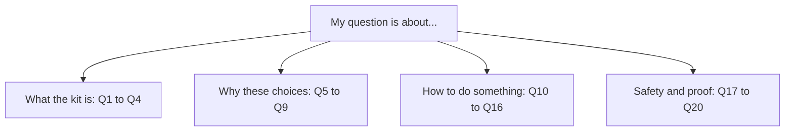
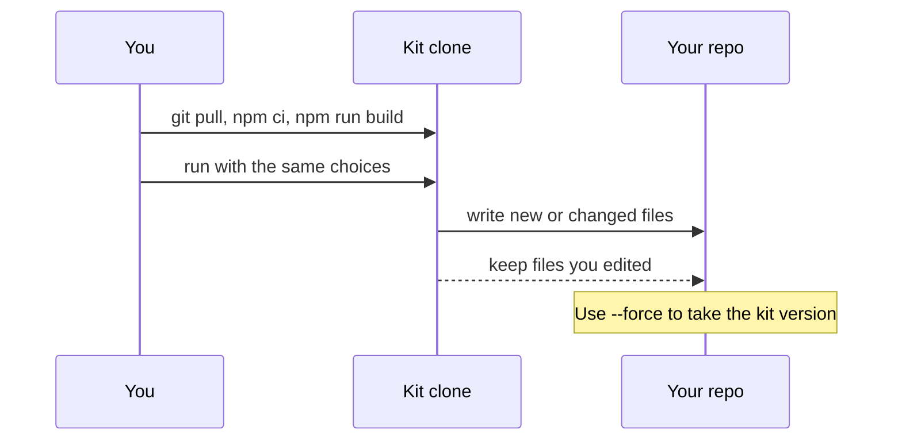

# 7. FAQ

> **In this chapter**
> Short answers to the 20 questions engineers ask most.
> Grouped as what, why, how and safety, each with the source file.
> Two diagrams: where to look for an answer, and how an update works.

## Find your question



## What

**Q1. What is the Coding Agent Kit?**
A CLI wizard. You pick an agent, optional IDE or ADE, skills, MCP servers and hooks. It writes the config files for those choices into your repo. Source: `coding-agent-kit/README.md`. See [chapter 1](01-what-and-why.md).

**Q2. Is it an agent or a runtime?**
No. It writes files and exits. It never runs or mediates your agent. Source: design spec, "Non-goals".

**Q3. What is in the catalog?**
5 agents (Claude Code, Codex, Cursor, GitHub Copilot, Oh My Pi), 2 IDE/ADE (VS Code, Orca), 57 skills, 10 MCP servers and 4 hooks. Source: `catalog-data/*.yaml`. Skill details are in [chapter 4](04-catalog-guide.md).

**Q4. What does it not do?**
It does not install software, log you in, manage model providers, write credentials or auto-update. It prints what you must do as "Next steps". Source: design spec, "Non-goals".

## Why

**Q5. Why not set up by hand?**
Hand setups drift between engineers and skip planning, isolation, cross-review, audit and secret scanning. The research behind the plan reports 88% of agent pilots never reach production, blamed on missing isolation and governance (Northflank, May 2026, quoted in `AI Workflow Research.md`). The kit makes those parts the default.

**Q6. Why skills, not just tools?**
A tool gives an agent a capability. A skill tells it when and how to work: plan first, write the test first, ask a second model to review. The kit installs skills so the flow is repeatable. The skills are plain `SKILL.md` folders (`catalog-data/skills/<id>/SKILL.md`). The flow is in [chapter 3](03-the-flow.md).

**Q7. Why is `using-superpowers` always installed?**
It is the rule that makes the agent check for skills at all. Letting someone uncheck it could silently disable the rest. Source: design spec, "Skills"; `catalog-data/skills.yaml` (`forced: true`).

**Q8. Why is secret scanning a hook and not a skill?**
Three baseline trials showed the agent already refused to leak secrets without any skill. The team chose a pre-commit `gitleaks` hook instead, which does not depend on agent judgment. Source: design spec, `secret-scanning-before-commit` note.

**Q9. Why is Cursor or Codex different from Claude Code?**
Each agent reads different paths.

| Agent | Instructions file | Skills dir |
|---|---|---|
| Claude Code | `CLAUDE.md` | `.claude/skills/` |
| Codex | `AGENTS.md` | `.agents/skills/` |
| Cursor | `AGENTS.md` | `.claude/skills/` |
| GitHub Copilot | `AGENTS.md` | `.claude/skills/` |
| Oh My Pi | `AGENTS.md` | `.claude/skills/` |

The kit picks the right paths from `catalog-data/agents.yaml`. You do not choose them.

## How

**Q10. Does it work with my agent?**
If it is one of the five above, yes. Another agent can be added as an `agents:` entry in `harness.overrides.yaml` (README, "Team overrides"). Nothing in the repo shows a tested example for a sixth agent, so test it before you roll it out.

**Q11. How do I add team skills?**
Put an entry under `skills:` in `harness.overrides.yaml` in the directory where you run the kit. Verified fields: `id`, `name`, `description`, `defaultChecked` and `actions` are all required. The `copyDir` source resolves against the kit's `catalog-data` folder, so keep your skill folder there or use a relative path from it.

```yaml
skills:
  - id: team-skill
    name: team-skill
    description: What it is for.
    defaultChecked: false
    actions: [{ kind: copyDir, source: skills/team-skill, target: "{skillsDir}/team-skill" }]
```

Then run `npx @anscodelab/coding-agent-kit --agent claude-code --skills team-skill --yes`. In a test, this wrote `.claude/skills/team-skill/SKILL.md`. More in [chapter 5](05-team-adaptation.md).

**Q12. How do I update?**
Pull the kit repo, rebuild, and re-run the same choices.



Source: README ("Re-runnable"); design spec ("re-running the wizard is the update mechanism").

**Q13. What if I already have a `CLAUDE.md`?**
Your text stays. The kit appends its own section between `<!-- enclave-agent-kit:claude-code -->` and a closing comment. In a test, an existing `# Mine` file kept its lines above the new section. Do not edit inside the section: the next run replaces it.

**Q14. What if I edited a file the kit wrote?**
Without `--force` the kit keeps your skill file, `.mcp.json` entry or `pre-commit` script. In non-interactive mode it does so silently (observed). The interactive dry run lists such files as `skipped` or `conflict`. With `--force` the kit version replaces yours. Details in [chapter 2](02-quickstart.md).

**Q15. Can I run it in CI or a script?**
Yes. Pass `--agent <id>` and `--yes`. Without a terminal and without `--agent` it exits with code 1 and the message `The interactive wizard needs a terminal. Run it in one, or pass --agent <id> --yes (see --help).`

**Q16. Can I preview before writing?**
Interactive wizard: yes, it shows the dry run and asks to confirm. Non-interactive: without `--yes` it only prints `N action(s) planned. Pass --yes to apply.` and writes nothing.

## Safety and proof

**Q17. Is it safe? Does it use the network or touch secrets?**
The kit source has no network calls and writes no credentials or `.env` files (README; design spec; a search of `src/` found no HTTP client). Two things run later, outside the kit. The agent starts the MCP servers in `.mcp.json` with `npx -y ...`. The pre-commit hook runs `gitleaks` if it is installed. If it is not, the hook prints a warning and lets the commit through.

**Q18. Does the secret hook block commits?**
Only when `gitleaks` is installed and finds something. If `gitleaks` is missing, the hook warns and exits 0. Source: `catalog-data/templates/hooks/pre-commit.sh.hbs`.

**Q19. How do I know the skills work?**
There is a benchmark of skills with and without each skill, per agent. In `~/eak-testlab/REPORT.md` (final for Claude Code and Oh My Pi; Cursor is partial, about 9 trials, stopped by its plan limit) the mean lift in mechanical checks is +25.5 points for Claude, +30.6 for Oh My Pi and +36.1 for Cursor. Some skills show 0 lift or negative lift, and some were not loaded by the agent. Read [chapter 6](06-measuring-effectiveness.md) before you quote any figure.

**Q20. Does the kit make my team better at AI coding on its own?**
No. It gives everyone the same setup. Skill in using the flow comes from the training and workshops in the AI Workflow Plan (`AI Workflow Plan.md`).

## Try it

Time: 10 minutes.

1. In a scratch repo, create `CLAUDE.md` containing the line `# Mine`.
2. Run `npx @anscodelab/coding-agent-kit --agent claude-code --yes`.
3. Run `head -3 CLAUDE.md`, then `grep -n coding-agent-kit CLAUDE.md`.

Expected result: `# Mine` is still the first line. The `grep` shows three lines: the opening marker, one sentence in the section that names the kit, and the closing marker (verified).

## Next

[08 Recipes](08-recipes.md), or back to [chapter 1: What the kit is and why it exists](01-what-and-why.md)
