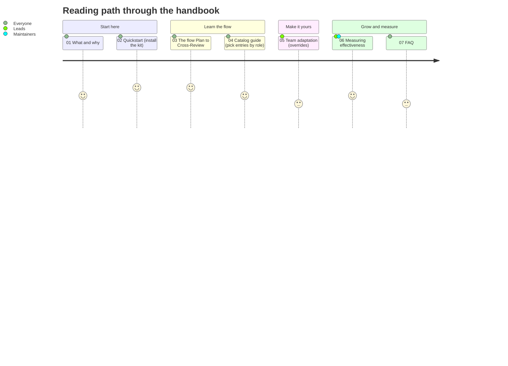
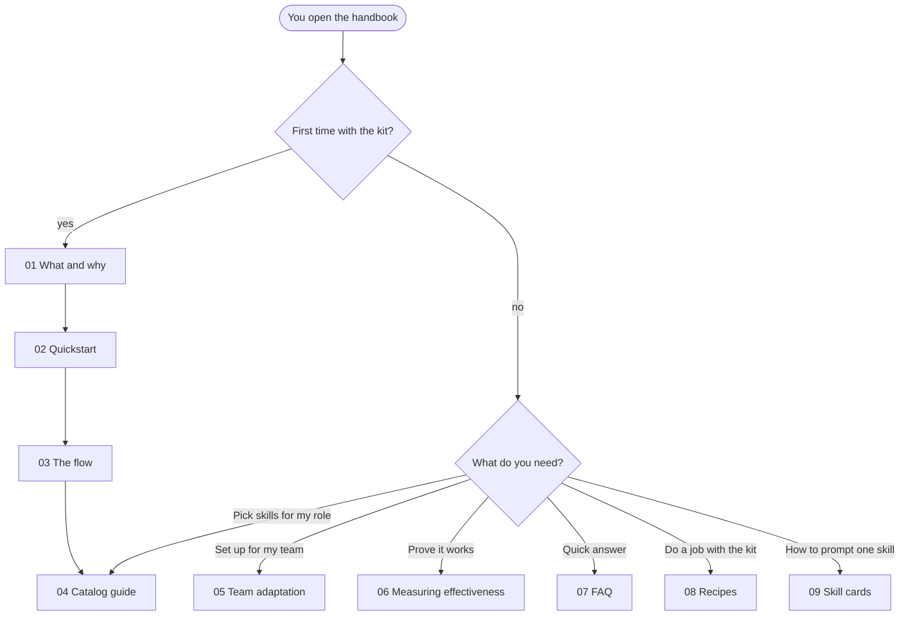

# Coding Agent Kit Handbook

> **In this chapter**
> The one-line pitch and a map of all chapters.
> Who should read what, and how long each part takes.
> A reading path for a first workshop and for day-to-day use.

## The pitch

**The Coding Agent Kit puts the same plan, review and audit habits into every repo where an engineer uses an AI coding agent, and this handbook shows how to use it and how to tell whether it works.**

The kit is a setup wizard. It writes config files (skills, MCP servers, hooks) into a repo and exits. It is not a runtime. Source: [`coding-agent-kit/README.md`](../../coding-agent-kit/README.md).

## Reading path

## Which path fits you

## Chapters

The times are planning targets for a workshop slot: reading plus the "Try it" exercise. Each exercise is 15 minutes or less.

| # | Chapter | Audience | Planned time |
|---|---|---|---|
| 01 | [What and why](01-what-and-why.md) | All engineers, new joiners | 10 min read |
| 02 | [Quickstart](02-quickstart.md) | All engineers | 10 min read + 15 min exercise |
| 03 | [The flow](03-the-flow.md) | All engineers | 15 min read + 15 min exercise |
| 04 | [Catalog guide](04-catalog-guide.md) | All engineers, by role | 10 min read + 15 min exercise |
| 05 | [Team adaptation](05-team-adaptation.md) | Team leads, platform owners | 10 min read + 15 min exercise |
| 06 | [Measuring effectiveness](06-measuring-effectiveness.md) | Team leads, kit maintainers | 20 min read + 15 min exercise |
| 07 | [FAQ](07-faq.md) | Everyone | 5 min read |
| 08 | [Recipes](08-recipes.md) | All engineers | 15 min read + one real job |
| 09 | [Skill cards](09-skill-cards.md) | Anyone picking or prompting a UI skill | Look up as needed |

## Where this fits in the AI Workflow Plan

The plan in `AI Workflow Plan.md` has a 3-month mission: help engineers get measurably better at using AI in software development. Its outputs map to chapters like this.

| Plan output | Chapter |
|---|---|
| Define a general flow (Plan, Parallelize, Verify, Cross-Review) | [03](03-the-flow.md) |
| Audit and roll out the harness tools | [02](02-quickstart.md), [04](04-catalog-guide.md) |
| Team-specific flow adjustments | [05](05-team-adaptation.md) |
| "Measurably better" | [06](06-measuring-effectiveness.md) |
| Workshops, training, Enclave Insights articles | Each chapter is written to be reused as workshop material or an article. |

## Try it

Pick your path above and open the first chapter on it. Write down one question you want the handbook to answer for you. Check at the end of that chapter whether it did.

Expected result: you have a chapter to start with and one question to test the handbook against.

**Next:** [01 What and why](01-what-and-why.md)
